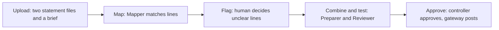
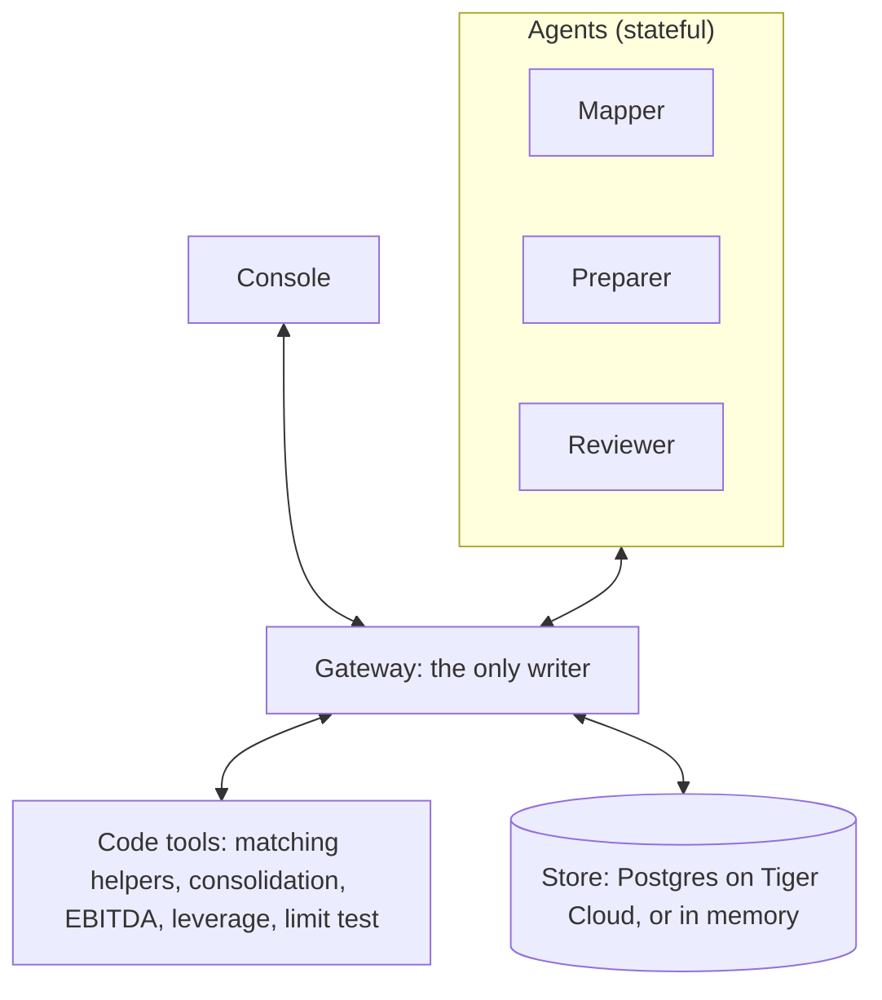

# Stochastic

**Merge an acquired company's books into the platform's books, flag the unclear lines for a human, and check the combined leverage against the lender's limit.**
Stochastic is built for private equity buy-and-build firms that keep buying add-on companies.
Three stateful AI agents do the repeatable work, code does all the math, and a human controller approves.
What the controller decides once, the agents keep and apply next time.

Built at Cal Hacks 13.0 (Oct 23-25, 2026, San Francisco) for the Hyphenate track, "The Hyphenated Enterprise: Autonomous Systems for Finance".

| | |
| --- | --- |
| Status | Backend runs the demo deal end to end on real filing figures (2026-10-24): mapping, flags with computed effects, consolidation with tie-out, covenant leverage 0.76x against 2.50x, maker-checker, hash-chained log, learned policies. The console runs on `GET /deals/{id}/case`: flag card, verdict line, combined table, mapping, log, backend badge. |
| Visibility | Private. |
| Team | UTSA, four people. |
| Start here | [`docs/STOCHASTIC.md`](docs/STOCHASTIC.md), the reference for features, architecture, and scope. |
| Who builds what | [`docs/TASKS.md`](docs/TASKS.md). |


An earlier idea was one all-in-one platform for any corporate-finance special situation.
It is archived as roadmap in `docs/planning-notes.md` and `docs/research/`.
It is not built, and the product is the integration workflow in this file.

## The problem

A PE firm that buys add-on companies repeatedly has a gate on each new deal.
The lender's agreement sets limits, such as a maximum debt-to-EBITDA ratio.
The lender tests these limits on the combined company.
So the next deal depends on how fast and how correctly the team can combine the books.

Today a finance team does this by hand.
They pull trial balances, map each account of the new company to the platform's chart of accounts in a spreadsheet, build the combined numbers, adjust EBITDA, and prepare the lender's compliance pack.
One vendor playbook puts a full integration at about 12 weeks. [self-reported, Aleph]
Errors in the mapping flow silently into every later number. [inferred]

## What Stochastic does

1. **Maps** each line of the target company to a line of the platform's chart, with a confidence and a short reason.
2. **Flags** only the unclear lines for a human, with both options and the effect on the result.
3. **Combines** the books in code: platform, target, and total, with EBITDA adjusted the way the agreement defines it. (Intercompany eliminations are cut for the weekend.)
4. **Tests** combined leverage against the lender's limit, using the covenant's own definitions of debt and EBITDA.
5. **Checks** the work with a reviewer agent, and a human controller approves. The agent that prepares a result cannot approve it, and the gateway refuses a number that no tool run produced.
6. **Logs** every action in an audit log, and each row is chained to the row before it.
7. **Learns.** The controller's answer to a flag becomes a policy. The Mapper applies it on the next run instead of asking again, and the log shows it.

## How it works

The workflow has five steps.
The user sees one screen with a flag card, a small combined table, and one verdict line.



The system has four parts.



Agents never talk to each other.
A job runner, which is code and not a model, moves work items from one agent to the next.
The console talks only to the gateway.

The agent layer uses one function, `run_agent(role, item)`, with four backends: `anthropic` (the real model path and the stage fallback), `droid` (the Factory Droid Python SDK, one session per role), `scripted` (deterministic rules, no model), and `replay` (recorded outputs).
`AGENT_BACKEND` picks one, `AGENT_FALLBACK` lists the fallbacks, and every result says which backend produced it.

### Design rules

- **Code does the math.** The model never produces a number.
- **Only the gateway writes.** An agent cannot change a record or approve its own work.
- **Use the covenant's own definitions.** A naive and a covenant leverage figure can differ a lot.
- **A tie-out check runs on every combined table.** The parts must add to the total.
- **Unsure means ask.** Precision comes before recall, so an unsure mapping becomes a flag.
- **Nothing is deleted.** A reversal is a new item linked to the original.

## The three agents

Each agent is stateful.
It receives one work item with all its inputs, plus its session and the policies it learned, and returns one typed result.
The state lives in the store, written only by the gateway, so it survives a restart. Today only a re-run of the same deal shows the memory; a second deal is not built.

| Agent | Real-team role | Gets | Returns | Never |
| --- | --- | --- | --- | --- |
| Mapper | Staff accountant | One company's lines, the platform's chart, and the covenant definitions from the brief | A mapping with confidence and reasons, a covenant tag for each line (debt, not debt, or unclear), and a list of flags | Guesses a low-confidence match or an unclear tag |
| Preparer | Senior accountant | Both mapped books and the approved flags | The draft combined table and the leverage figure, from tool calls | Computes a number itself, or approves its own draft |
| Reviewer | Reviewer | The draft and the limit | Pass or needs-attention, with reasons | Changes the draft |

The human controller approves flagged lines and the final result.

Planned, not built: a fourth agent, the Brief Reader (credit analyst), reads the credit agreement and drafts the brief with a verbatim quote for every field.
The gateway refuses a quote that is not in the agreement and a number that is not in its quote, and the controller approves the brief before mapping starts.
Today a person writes the brief. See `docs/architecture/brief-reader.md`.

## The demo

The proof deal is Kewaunee Scientific buying Nu Aire, closed 2024-11-01, for $55M. [verified]
Kewaunee is the platform. Nu Aire is the target.
The data comes from public filings: Nu Aire's audited statements, Kewaunee's pro forma statements with a note that maps Nu Aire's lines, and the PNC credit agreement.
Public filings give statement lines, not trial balances, so the demo maps statement lines.

**The one flag** is real: Kewaunee's "Financing liability" line.
It holds the Statesville sale-leaseback ($27,782K), the new PNC term loan and revolver ($20,563K), and the 8% seller notes ($22,540K). [verified]
The credit agreement's Senior Funded Bank Debt excludes the capital lease on that property and subordinated debt.
So the agent asks the controller which parts count, and each option shows the leverage it gives, computed by the tools.
Read as filed, counting the whole line over reported EBITDA gives 2.84x, over the 2.50x limit. The agreement's reading gives 0.76x. [verified: `backend/tests/test_demo_run.py`]

**The one screen** has the flag card with its options and effects, a combined table (the combined balance sheet balances at $182,456K of total assets), and one verdict line that shows combined leverage against the 2.50x limit with the room left.
The audit log is a small link.

Pitch time is 1:30, and the live demo is 0:30.
The screen says which backend produced the agent output.
The gateway, the math, and the audit log are real.
Run the deal again after a reset and the Mapper asks nothing: the controller's answer became a policy.

## MVP scope

Status on 2026-10-24 is in `docs/STOCHASTIC.md`, section 13.
Done: the input data from the filings, the three agents through `run_agent`, the tools with tests on the real figures, the gateway with maker-checker, run-id checks, the audit log, and agent memory, the recorded run and the backend switch.
Also done: the console on the case API, live model runs on Droid (and on the Anthropic API with a teammate's key), the Note 2 answer-key score, the Postgres store on Tiger Cloud with what-if forks, and gateway guards against model-made exclusions, borrowed run ids, and unbacked review passes.
Cut for the weekend: purchase accounting, intercompany eliminations, other deals, login, the trailing-twelve-month test period, a live SEC call, a staged denial.

## Tracks

We target four tracks. [set by Cayden, 2026-10-24]

| Track | What we show |
| --- | --- |
| Hyphenate (main) | A real messy corner (two charts of accounts from a real deal), an answer key, limits in code, and one moment: the flagged line that changes the leverage verdict. |
| Factory | The agents run through the Droid SDK, one resumed session per role, with a tool allowlist and typed output. |
| Figma | The console is designed in Figma and built from the Figma frame. The Figma file and one agent-driven edit are on screen in the pitch. |
| Tiger Data | The record, the hash-chained audit log, and the agents' memory live in Postgres on Tiger Cloud. The audit log is a TimescaleDB hypertable that refuses edits, and a restart loads everything back. Each covenant flag's what-ifs live in a zero-copy fork of the ledger until the answer deletes it. |

Other tracks are not targeted. The details, the per-track checklist, and the open questions are in section 15 of `docs/STOCHASTIC.md`.

## Tech stack (proposed)

| Layer | Choice |
| --- | --- |
| Frontend | Next.js, React, TypeScript, Tailwind (the console) |
| Backend | Python, FastAPI (gateway, tools, tests) |
| Agents | Python, `run_agent(role, item)`: `anthropic`, `droid` (Factory Droid Python SDK 0.5.0), `scripted`, `replay` |
| Store | In memory, written through to Postgres on Tiger Cloud with `STORE=postgres`; agent memory kept across resets |
| Models | Claude Haiku 5.5 by default on both backends (`DROID_MODEL`, `ANTHROPIC_MODEL`), with per-role overrides such as `DROID_MODEL_MAPPER`. The Factory key lists Claude, GPT, and Gemini models |
| Keys | `ANTHROPIC_API_KEY` and `FACTORY_API_KEY` live in the repo-root `.env`, which git ignores and the app loads |

## Repository layout

```
stochastic/
  README.md            This file
  CLAUDE.md            Instructions for Claude Code
  .env.example         Names of the settings the app will need (no secrets)
  docs/
    STOCHASTIC.md      Reference: features, architecture, scope
    TASKS.md           Who builds what
    architecture/      Parts, agents and work items, gateway and API, data model
    design/            Figma links, tokens, and UI rules
    research/          Sourced research, including the deal and workflow files
    sponsors/          Sponsor and track research
    diagrams/          PDFs from the first framing (stale)
    planning-notes.md  Archive from earlier framings
    hyphenate-workshop.md
  backend/             FastAPI gateway, agents and backends, deal math, fixture, tests, recordings
  frontend/            Console: Next.js, Tailwind (being rebuilt on GET /deals/{id}/case)
  evals/               Answer key and scoring (Eric, planned)
  data/                Cached public filings and CSVs (git-ignored)
  e2e/                 Playwright end-to-end suite: the demo path in the browser and in the Mac app
  scripts/             droid_probe.py (can Droid run Claude?) and record_run.py (run and record a backend)
```

## Getting started

Run the backend and the console in two terminals.

```
cp .env.example .env                                        # then add keys; AGENT_BACKEND=scripted needs none

cd backend
uv venv --python 3.12 .venv
uv pip install -p .venv/bin/python fastapi "uvicorn[standard]" pydantic pytest httpx python-dotenv python-multipart anthropic "droid-sdk[mcp]" "psycopg[binary]" openpyxl
.venv/bin/python -m pytest -q                               # 318 passed, 14 skipped on the real figures (verified 2026-10-24); the skips are the Tiger store tests, which need TEST_DATABASE_URL
.venv/bin/uvicorn app.main:app --port 8000 --reload

cd frontend
npm install
npm run dev                                                 # http://localhost:3000 (Dashboard; the Case is /case)
```

Run the deal without the console:

```
curl -X POST localhost:8000/deals/d_kequ_nuaire/run          # Mapper runs, stops on the flag
curl localhost:8000/deals/d_kequ_nuaire/case                 # the whole screen, including open_flags
curl -X POST localhost:8000/work-items/wi_002/answer -H 'content-type: application/json' -d '{"option_id":"b"}'
curl -X POST localhost:8000/work-items/wi_003/answer -H 'content-type: application/json' -d '{"option_id":"a"}'
curl -X POST localhost:8000/deals/d_kequ_nuaire/run          # Preparer and Reviewer run; verdict 0.76x against 2.50x
curl -X POST localhost:8000/work-items/wi_006/approve        # controller approves; the gateway posts
curl -X POST localhost:8000/dev/reset && curl -X POST localhost:8000/deals/d_kequ_nuaire/run   # second run: no flag
```

Or from the command line: `backend/.venv/bin/python scripts/record_run.py --backend scripted`.
End-to-end tests over the whole demo path, in the browser and in the Mac app: `cd e2e && npm ci && npm run e2e` (about 3 minutes, scripted agents only, on free ports; see `e2e/README.md`).
The console reads `NEXT_PUBLIC_API_URL` (default `http://localhost:8000`) and `GET /deals/{id}/case`.
`POST /dev/reset` reseeds the deal and keeps the agents' memory; add `?keep_memory=false` to clear it.
The Droid backend needs the `droid` CLI on PATH: `curl -fsSL https://app.factory.ai/cli | sh`.

## Documentation

| File | What it holds |
| --- | --- |
| [`docs/STOCHASTIC.md`](docs/STOCHASTIC.md) | The reference. Read it first. |
| [`docs/TASKS.md`](docs/TASKS.md) | Who builds what, the shared contract, and the order of work |
| [`docs/agents.md`](docs/agents.md) | The agents: roles, memory, backends, settings, run log |
| [`docs/tasks/`](docs/tasks) | One task file per person, with branches and owned folders |
| [`docs/demo-script.md`](docs/demo-script.md) | The 2:00 plan, the 30-second demo beat by beat, failure plan, and judge Q&A |
| [`docs/glossary.md`](docs/glossary.md) | Finance terms in plain language, with examples from the Kewaunee deal |
| [`docs/decisions.md`](docs/decisions.md) | The dated decision log: how we got from three framings to this one |
| [`docs/architecture/`](docs/architecture) | Parts, agents and work items, gateway and API, data model, repo structure |
| [`docs/research/ma-workflow-research.md`](docs/research/ma-workflow-research.md) | The three M&A users, pain, time, and existing products |
| [`docs/research/post-close-deliverables.md`](docs/research/post-close-deliverables.md) | What a PE finance team gets after an add-on closes |
| [`docs/research/real-deal-candidates.md`](docs/research/real-deal-candidates.md) | The real deal, with EDGAR links |
| [`docs/research/agent-framework-options.md`](docs/research/agent-framework-options.md) | Droid, ADK, Anthropic API, and others |
| [`docs/hyphenate-workshop.md`](docs/hyphenate-workshop.md) | The Hyphenate workshop blueprint and the gaps |
| [`docs/sponsors/`](docs/sponsors) | Sponsor research for Hyphenate, Tiger Data, Microsoft, Factory, and Mana |
| [`docs/diagrams/`](docs/diagrams) | PDFs from the first framing. Stale. |

## A worked example of the flag

Every figure is from the filings or computed by the tools. [verified: `backend/tests/test_trust_rules.py`]

1. Kewaunee's balance sheet has one line, "Financing liability". At 2024-10-31 it was $750K current plus $27,032K long-term, a sale-leaseback of the Statesville property carried at $27,782K. [10-Q]
2. At close the pro forma adds $43,103K to the same line: the $15,000K term loan, the $5,563K revolver draw, and the $22,540K seller notes. [Ex 99.2 Note 4(h)]
3. The credit agreement's Senior Funded Bank Debt excludes the capital lease on that property and excludes subordinated debt. [Ex 10.1]
4. The Mapper tags the line unclear and raises a flag with three options. The gateway runs the tools for each option and writes the effect on the card.
5. Whole line, read as filed: debt $71,955K over reported EBITDA $25,312K, leverage 2.84x, over the limit. Agreement's reading: debt $21,633K, leverage 0.76x, OK. Bank debt plus seller notes: 1.56x.
6. Covenant EBITDA is $28,379K: both companies' net income plus interest expense less interest income, plus taxes, depreciation, and amortization, plus the $4,019K noncash pension termination add-back and $1,018K of stock-based compensation, less $1,970K of Statesville cash rent (inferred from the 10-K obligations table).
7. The controller picks b. The Preparer calls consolidate, ebitda, covenant_debt, and leverage. The Reviewer calls tie_out and limit_test. The controller approves and the gateway posts.
8. Reset and run again with memory kept: the Mapper applies the policy and asks nothing. Between judges, reset with memory cleared so the flag comes back.

## Team and branches

| Person | Area | Branch | Task file |
| --- | --- | --- | --- |
| Cayden | Agents, gateway, demo | `cayden/agents` | [`docs/tasks/cayden.md`](docs/tasks/cayden.md) |
| Josie | UI and UX only | `josie/design` | [`docs/tasks/josie.md`](docs/tasks/josie.md) |
| Eric | Data, input files, answer key, Devpost draft | `eric/data` | [`docs/tasks/eric.md`](docs/tasks/eric.md) |
| Tri | Math tools, tests, API | `tri/tools` | [`docs/tasks/tri.md`](docs/tasks/tri.md) |

Each person edits only the folders they own. The rules for parallel work are in [`docs/tasks/README.md`](docs/tasks/README.md).
Cayden owns the shared data contract in `backend/app/core/models.py`.

## Open questions

- Does PE add-on integration count as a corner of a finance team for Hyphenate? Ask a Hyphenate mentor on Saturday.
- Which reading of Kewaunee's financing liability is right? All three are computed; a practitioner should confirm the default.
- Droid runs Claude Sonnet 5.5 and Haiku 5.5 on our key (answered 2026-10-24).
- The Anthropic API backend ran on Eric's key; the demo laptop has none, so it is not in the stage fallback chain.

The full list is in section 18 of `docs/STOCHASTIC.md`.

## Honesty notes

- Claims in the docs are tagged verified or inferred. No practitioner has checked the user assumptions.
- The demo is a reconstruction from public filings. It does not show the internal views of the lender or the company.
- The screen says which backend produced the agent output: anthropic, droid, scripted, or replay. The gateway, the math, and the audit log are real.
- The rent deduction and zero transaction costs in covenant EBITDA are inferred, not filed figures. The combined table is historical plus target, without purchase accounting, and the two fiscal years differ.
- The output is a mapped, combined set of books and a limit check that a human approves. It is not advice.
- Other situations are roadmap, not built.
- Sponsor and vendor numbers are self-reported.

## License

None yet. This repository is private, and all rights are reserved until the team decides.

## Acknowledgments

Travel supported by the UTSA College of AI, Cyber and Computing (CAICC) Student Success Center.
