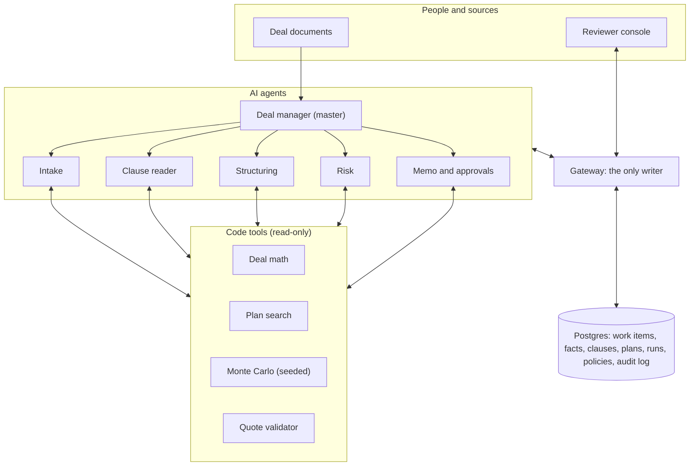
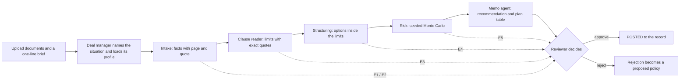

# Stochastic

**One platform for any special situation in corporate finance.**
Special situations are one-off, high-stakes moves outside the normal course of business.
Examples are raising money, refinancing, selling part of a company, and a company in trouble.
Stochastic is a team of AI agents that works out what a company is allowed to do, finds what blocks it, builds and tests the options, and asks a senior human before anything is committed.

Built at Cal Hacks 13.0 (Oct 23-25, 2026, San Francisco) for the Hyphenate track, "The Hyphenated Enterprise: Autonomous Systems for Finance".

| | |
| --- | --- |
| Status | Pre-build. No project code yet. Code starts after hacking opens on Friday Oct 23, about 6pm. |
| Visibility | Private. |
| Team | UTSA, four people. |
| Start here | [`docs/STOCHASTIC.md`](docs/STOCHASTIC.md), the short reference for features, architecture, and scope. |

## The problem

Special situations are hard for three reasons.
The rules are buried in long agreements.
The options are many, and the terms keep changing.
A mistake is costly.

Today a small team of specialists reads the agreements, finds the limits, designs the options, tests the risk, and asks a senior person to approve.
When a term changes, the team redoes the work.
This work is slow and manual.

## What Stochastic does

1. **Reads** the documents and turns them into facts. Each fact keeps its page and exact quote.
2. **Finds the limits.** It locates the clauses that allow or block a plan, and a code check confirms that each quote is really in the document.
3. **Designs the options.** It builds financing mixes inside the limits and keeps the best trade-offs.
4. **Tests the risk.** A seeded Monte Carlo run shows the odds of a breach or a loss.
5. **Asks early.** The agents stop and ask the human reviewer at six points, not only at the end.
6. **Proves it.** Every action and every denied attempt goes in an append-only audit log.

## How it works



Agents never chat with each other.
They pass typed work items through the gateway.
The gateway is the only part that writes to the record.

### One deal, start to finish



### The six agents

| Agent | Job | Asks the human at | Never |
| --- | --- | --- | --- |
| Deal manager (master) | Names the situation, loads the profile, makes tasks, marks stale results | Any conflict between results | Does the math or writes a record |
| Intake | Turns documents into facts with page and quote | E1 missing document, E2 facts to confirm | Guesses a missing number |
| Clause reader | Finds limits with exact quotes and confidence | E3 unclear clause or term | Keeps a quote that the validator cannot find |
| Structuring | Builds financing mixes and the shortlist | E4 plan blocked | Invents terms or computes numbers itself |
| Risk | Chooses scenarios and explains the results | E5 best plan flips after an event | Reports a number without a seed and run id |
| Memo and approvals | Writes the memo and proposes a policy after a rejection | E6 final decision | Approves its own work |

### Design rules

- **Code does the math.** The model never produces a number.
- **Only the gateway writes.** An agent cannot change a record or approve its own work.
- **Vectors find, tables decide.** Search finds the passage. Exact facts live in tables.
- **A denied action is evidence.** The gateway logs it and does not apply it.
- **Nothing is deleted.** A reversal is a new item linked to the original.
- **Unsure means ask.** Precision comes before recall.

## Situations

One engine serves all eight situations.
A situation profile changes what the agents look for, weigh, and ask.
The profile sets the scope, the information needed, the instruments allowed, the objective weights, the impact measures, and the escalation thresholds.
The demo runs one situation.

| Situation | Goal | Limits checked first |
| --- | --- | --- |
| Raising money | New capital at low cost and low dilution | Debt baskets, restricted payments, liens |
| Company in trouble | Buy time and avoid default | Covenant breach, cross-default, waiver terms |
| Refinancing | Replace debt on better terms | Prepayment premiums, call protection, maturity |
| Mergers and acquisitions | Fund or structure a deal | Acquisition baskets, lender consent |
| Selling part of a company | Raise cash from an asset sale | Asset-sale limits, required prepayment |
| Borrowing against assets | Secured loan on receivables or equipment | Lien limits, borrowing base, advance rates |
| Ownership changes | Buyout, recap, or new owners | Change of control, consent rights |
| Bankruptcy | Spot it early and hand it to experts | Default triggers (proposed: stop and ask a human) |

The default profile values come from public sources and our own inference.
No practitioner has checked them, and the reviewer can change every value.

## Demo and MVP

The weekend demo runs one real public deal end to end for one situation.
A judge can watch the platform read the documents, find a clause that blocks the first plan, log it as a denied action, re-plan with a priced consent route, and ask a human to approve.

**Must have**
- One real deal, cached, with an answer key.
- Intake agent and clause reader with the quote validator.
- Gateway, work-item states, and an audit log that records denied actions.
- Deal math and plan search.
- Monte Carlo with a run id on every result.
- Memo agent and reviewer console.
- At least four escalations: E2, E3, E4, and E6.

**Should have**
- A rejection that becomes a policy.
- Event injection, such as a rate move that raises E5.
- Database forks for what-if plans.
- A catch-rate score against the answer key.
- Adversarial tests.

**Cut for the weekend**
- Test cases for the other seven situations.
- Arbitrary uploads, accounts, mobile, and many deals.
- Live SEC calls on stage.

## Tech stack (proposed)

| Layer | Choice |
| --- | --- |
| Frontend | Next.js, React, TypeScript, Tailwind (the reviewer console) |
| Backend | Python, FastAPI, NumPy (state machine, gateway, math, Monte Carlo) |
| Data | Postgres on Tiger Cloud, with pgvector or pgvectorscale and forks |
| Models | Claude through the Anthropic API |
| Public data | SEC EDGAR, NY Fed SOFR, FRED, Census, Damodaran |

## Repository layout

```
stochastic/
  README.md            This file
  CLAUDE.md            Instructions for Claude Code
  .env.example         Names of the settings the app will need (no secrets)
  docs/
    STOCHASTIC.md      Short reference: features, architecture, scope
    planning-notes.md  Original planning README (archive)
    hyphenate-workshop.md
    research/          Sourced research and the nine deep-problem files
    diagrams/          Architecture and flow PDFs with their HTML sources
    sponsors/          Sponsor and track research
  backend/             Gateway, agents, tools, database (planned)
  frontend/            Reviewer console (planned)
  evals/               Answer key and scoring (planned)
  data/                Cached public filings (git-ignored)
  scripts/             Helper scripts (planned)
```

## Getting started

There is nothing to run yet.
Setup steps will go here when the first code lands.
To read the design, open `docs/STOCHASTIC.md` and then the PDFs in `docs/diagrams/`.

## Documentation

| File | What it holds |
| --- | --- |
| [`docs/STOCHASTIC.md`](docs/STOCHASTIC.md) | The reference. Read it first. |
| [`docs/diagrams/`](docs/diagrams) | Big picture, deal flowgraph, agents and data, and the MVP build plan |
| [`docs/hyphenate-workshop.md`](docs/hyphenate-workshop.md) | The Hyphenate workshop blueprint and the gaps |
| [`docs/research/`](docs/research) | Research on clause reading, option search, Monte Carlo, approvals, data, novelty, taxonomy, deals, and profiles |
| [`docs/sponsors/`](docs/sponsors) | Sponsor research for Hyphenate, Tiger Data, Microsoft, Factory, and Mana |

## Open questions

- Does deal structuring count as a corner of a finance team for the Hyphenate track?
- Does redeemable preferred count as debt under the demo agreement? A practitioner must confirm.
- Which past decisions do we seed so the rejection-to-policy loop has evidence?
- Which sponsor tools can run alongside our stack without touching the gateway, the audit log, or the deal math?

The full list is in section 18 of `docs/STOCHASTIC.md`.

## Honesty notes

- Every claim in the research files is tagged verified or inferred. No practitioner has checked the assumptions.
- The demo is a reconstruction from public filings. It does not show the internal views of any lender.
- Sponsor prize numbers are self-reported by the sponsors.

## License

None yet. This repository is private, and all rights are reserved until the team decides.

## Acknowledgments

Travel supported by the UTSA College of AI, Cyber and Computing (CAICC) Student Success Center.
