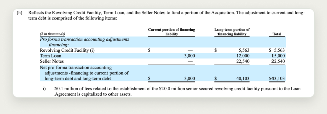
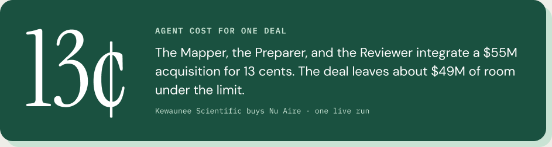
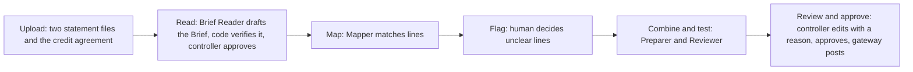
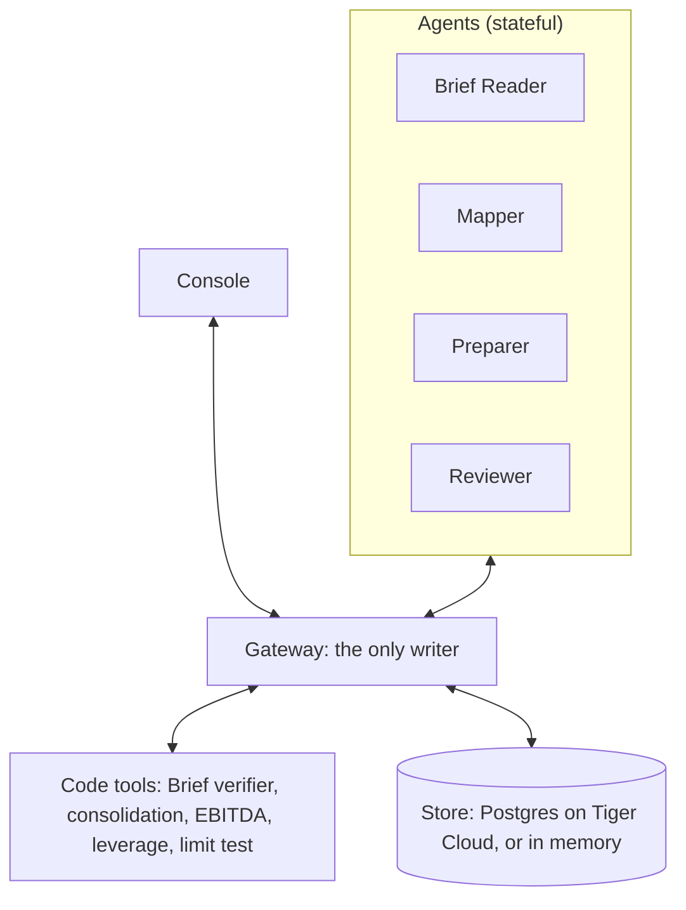
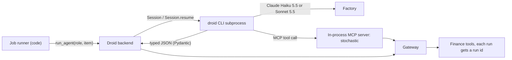

<p align="center">
  
</p>

<h1 align="center">Stochastic</h1>

<p align="center">
  <b>Four AI agents that merge an acquired company's books, ask a human only about the lines that matter, and never do the math themselves.</b> · Built at Cal Hacks 13.0, San Francisco, October 23-25 2026.
</p>

<p align="center">
  
  
  
</p>

---

## The problem

A private equity firm that runs a buy-and-build strategy buys one company, then keeps bolting smaller ones onto it.
Every one of those add-ons runs into the same gate: the lender.

The credit agreement says the combined company can only carry so much debt for every dollar of EBITDA.
Before the next deal can close, someone has to prove the combined books stay under that line.
So the speed of the whole strategy comes down to how fast a finance team can merge two sets of books, and how sure they are that they got it right.

Today that is a spreadsheet.
Someone pulls both companies' statements, maps every line of the new company onto the platform's chart of accounts by hand, rebuilds the combined numbers, adjusts EBITDA the way the lawyers defined it, and builds the lender's compliance pack.
One vendor playbook puts a full integration at about 12 weeks. [self-reported, Aleph]

And the dangerous part is quiet.
One line mapped the wrong way flows into every number after it, and nobody notices until the lender does. [inferred]

## What Stochastic does

You drop in two sets of financial statements and the credit agreement.
Four agents split up the work a real finance team would:

1. **Read** the credit agreement and pull out the limit, what counts as debt, and how EBITDA is adjusted, with a verbatim quote for every field.
2. **Map** every line of the target onto the platform's chart, with a confidence and a reason.
3. **Flag** only the lines that are genuinely unclear, and show the human what each answer would do to the result.
4. **Combine** the books and **test** leverage against the lender's limit, using the agreement's own definitions.
5. **Review** the draft, and hand it to a human controller to approve.

Then it remembers.
What the controller decides once becomes a policy, and the next run applies it instead of asking again.

### The model never produces a number

Every figure on screen came out of a code tool, and the gateway refuses any number that no tool run produced.
The agents decide which tool to call and how to read a messy line.
Code does the arithmetic.

The agent that prepares a result cannot approve it.
Only the gateway writes to the record.
Every action lands in an audit log where each row is chained to the hash of the row before it, so nothing can be quietly rewritten.

That is the whole bet: let the model handle the judgment, keep it away from the math, and make a human sign the parts that carry weight.

---

## The moment it earns its keep

The demo deal is real: Kewaunee Scientific buying Nu Aire, closed November 1 2024, for $55M. [verified]
Every figure below comes from the public filings or from the tools. [verified: `backend/tests/test_trust_rules.py`]

Kewaunee's balance sheet has one line called "Financing liability."
It looks like debt.
Mostly it is not, at least not the way the lender counts it.

| What is inside that one line | Amount |
| --- | --- |
| Sale-leaseback of the Statesville property | $27,782K |
| New PNC term loan and revolver draw | $20,563K |
| 8% seller notes | $22,540K |

<p align="center">
  
  <br><sub>Note 4(h) of the 8-K/A Ex 99.2. Three very different kinds of money, one line.</sub>
</p>

The credit agreement's Senior Funded Bank Debt excludes the capital lease on that property, and excludes subordinated debt.
So the Mapper does not guess.
It tags the line unclear and asks.
For each option, the gateway runs the tools and writes the effect right on the card:

| Reading | Leverage | Against the 2.50x limit |
| --- | --- | --- |
| The whole line, as filed | **2.84x** | Over the limit. The deal looks blocked. |
| Bank debt plus seller notes | 1.56x | OK |
| The agreement's own definition | **0.76x** | OK, with plenty of room |

Same company, same day, and the answer flips between "you are in breach" and "you have room for another deal" depending on one line.
That is the line a human should decide, and the only one Stochastic asks about.

The controller picks the agreement's reading.
The Preparer calls `consolidate`, `ebitda`, `covenant_debt`, and `leverage`.
The Reviewer calls `tie_out` and `limit_test`.
The controller approves, and the gateway posts.

Then reset and run it again with memory kept.
The Mapper applies the policy it learned and asks nothing, and the log shows why.

<p align="center">
  
</p>

---

## How it works



The human steps are two.
First, the controller approves the Brief in one click, once the verifier shows 22 of 22 checks passed.
Second, the Mapper's one escalation asks two questions together: which parts of the financing liability count as debt, and where Nu Aire's certificates of deposit and five other lines go.

Behind the console there are four parts:



Agents never talk to each other.
A job runner, which is plain code, moves work items from one agent to the next.
The console talks only to the gateway.

---

## The agents

Each one maps to a person on a real finance team, and each one has a short list of things it is never allowed to do.

| | Agent | The real job | Hands back | Never |
| --- | --- | --- | --- | --- |
|  | **Brief Reader** | Credit analyst | A draft Brief: the limit, what counts as debt, the EBITDA adjustments, each with a quote and a section | Computes a number, fills a field without a quote, or approves its own Brief |
|  | **Mapper** | Staff accountant | A mapping with confidence and reasons, a covenant tag on every line, and a list of flags | Guesses a low-confidence match or an unclear tag |
|  | **Preparer** | Senior accountant | The draft combined table and the leverage figure, from tool calls | Computes a number itself, or approves its own draft |
|  | **Reviewer** | Reviewer | Pass or needs-attention, with reasons | Changes the draft |

The agents are stateful.
Their sessions and learned policies live in the store, written only by the gateway, so they survive a restart.
A policy follows the company it was learned on, onto any deal: the seeded QuickBooks case reuses the answer given on DLH's earlier deal.

The Brief Reader is the one we trust least, so it gets checked hardest.
The gateway refuses a quote that is not in the agreement and a number that is not in its quote.
Then a code verifier checks every field against the agreement (22 checks on the demo deal) and fills the adjustment amounts from the books with their sources.
Mapping does not start until the controller approves the Brief.

---

## How Factory Droid runs the agents

Droid is the agent runtime on the demo laptop.
With `AGENT_BACKEND=droid`, every live model turn is a Factory Droid session, driven from Python through the Droid SDK (`droid-sdk[mcp]` 0.5.0), in [`backend/app/agents/backends/droid_backend.py`](backend/app/agents/backends/droid_backend.py).
The agent layer is one function, `run_agent(role, item)`, and Droid is one of its four backends next to `anthropic`, `scripted`, and `replay`.

### Where it sits



The job runner hands one work item to `run_agent(role, item)`.
The Droid backend opens that role's session, sends the item, and gets back JSON that must parse as the role's Pydantic output type.
When the agent needs a number, it calls a tool, and the tool call goes through the gateway, so every figure gets a run id the gateway can check later.
The agent never touches the store directly.

### How each session is set up

```python
config = SessionConfig(
    mcp_servers=[server],          # our tools, served in-process
    restrict_tools=allowed,        # only this role's tools, nothing else
    autonomy=Autonomy.HIGH,
    system_prompt=role.system,
)
session = Session(cwd=role_dir(role.name), config=config)   # or Session.resume(session_id, ...)
result = session.stream(prompt, output=role.output_type, timeout=timeout)
```

- **One persistent session per role.** The first call creates it, every later call resumes it by id with `Session.resume`, across work items and across deals. That is how the agents keep their memory between runs.
- **Our tools, and only our tools.** The six finance tools plus the Brief Reader's two reading tools are Python functions served through Droid's in-process MCP server (`create_sdk_mcp_server`). `restrict_tools` allows nothing else, so Droid cannot reach for a shell or the file system.
- **Each role gets its own slice:**

  | Role | Tools through Droid |
  | --- | --- |
  | Brief Reader | `get_section`, `get_definition` |
  | Mapper | none. It cannot compute a number even if it tried |
  | Preparer | `consolidate`, `ebitda`, `covenant_debt`, `leverage` |
  | Reviewer | `tie_out`, `limit_test`, `leverage` |

- **An empty folder per role.** Droid is a coding agent and reads files by default, so each role runs in its own empty directory (`~/.cache/stochastic/droid/<role>`). It also keeps each role's turns grouped together in Factory.
- **Typed output.** Each turn's answer is parsed into the role's Pydantic model, so a malformed answer fails loudly instead of slipping through.
- **Rewind on refusal.** If the gateway refuses a Mapper result, the runner retries once and first calls `Session.rewind` to before the refused turn, so the bad answer is not left in the agent's memory. [verified: `scripts/droid_rewind_probe.py`]
- **Fresh session when the setup changes.** A resumed session keeps the system prompt, model, effort, and tools it started with, so the backend stores a fingerprint of them and opens a new session when any of them change.

### What we confirmed about it

- **The model that actually ran.** The SDK result does not say which model served the turn, so the backend reads the droid CLI's own session record (`~/.factory/sessions/...jsonl`) and records `model_served` and `model_confirmed`. [verified]
- **Models.** Haiku 5.5 by default (`DROID_MODEL`), with the Mapper on Sonnet 5.5 for the demo (`DROID_MODEL_MAPPER`), and reasoning effort pinned to medium. `scripts/droid_probe.py` calls `list_models()` to see what the key can run.
- **Cost.** Every run reports `factory_credits`. One full deal on Haiku 5.5 at medium was 11,942 credits; the second deal, with memory kept, was 7,291. [verified: run log in `docs/agents.md`]
- **Memory survives.** With `STORE=postgres`, a restart of the API loaded the sessions, policies, and audit rows back from Tiger Cloud, and all three roles resumed their earlier sessions on the next deal. [verified: run log, 2026-10-24]

### When Droid is not there

`AGENT_BACKEND=droid` is the first choice on the demo laptop.
`AGENT_FALLBACK` lists what runs if Droid fails: the `scripted` rules by default, and `anthropic` (the Anthropic API) when a key is in `.env`.
We rehearsed it with the `droid` CLI missing from PATH: the run came back as "mapper ran on scripted", and `GET /health` listed each attempt and why it failed.
The two on-stage demo beats replay a recorded live Droid run (`backend/recordings/haiku-5-5-run2/`, Mapper 33 of 33 against the answer key), so the demo never depends on conference WiFi.
Every result, and the sidebar's model card, says which backend produced it.

---

## The console

Six pages, in sidebar order:

| Page | What is on it |
| --- | --- |
| Dashboard | Every case, with Upload and Run the demo |
| Case | The Brief, the questions, the live pipeline, and leverage against the limit |
| Mapping | Every line and where it went |
| Agents | The 3D Agent House and the agents' conversation, live |
| Log | The hash-chained audit log |
| Review | The books to edit with a reason, Approve, and Download final files |

It runs in the browser and as a Mac app (Electron).
The Dashboard also holds four more seeded cases: three real deals from their filings (DLH and GRSi, Mama's Creations and Crown I, Shutterstock and Envato) and one QuickBooks sample.

## Tracks

| Track | What we show |
| --- | --- |
| Hyphenate (main) | A real messy corner of finance (two charts of accounts from a real deal), an answer key, limits in code, and one moment: the flagged line that changes the leverage verdict |
| Factory | The agents run through the Droid SDK, one resumed session per role, with a tool allowlist and typed output |
| Figma | The console is designed in Figma and built from the Figma frame |
| Tiger Data | The record, the hash-chained audit log, and the agents' memory live in Postgres on Tiger Cloud. The audit log is a TimescaleDB hypertable that refuses edits. Each covenant flag's what-ifs live in a zero-copy fork of the ledger until the answer deletes it |

---

## What is real, and what is not

- The gateway, the math, the verifier, and the audit log are real, and the tests run on the real filing figures.
- The two demo beats replay a recorded Claude Haiku 5.5 run, so they never depend on conference WiFi. The sidebar's model card always says which backend produced what you are seeing.
- Public filings give statement lines, not trial balances, so the demo maps statement lines.
- The demo is a reconstruction from public filings. It does not show the lender's or the company's internal views.
- The rent deduction and zero transaction costs in covenant EBITDA are inferred, not filed. The combined table is historical plus target, without purchase accounting, and the two fiscal years differ.
- Cut for the weekend: purchase accounting, intercompany eliminations, login, the trailing-twelve-month test period, and a live SEC call.
- No practitioner has checked our user assumptions yet. Sponsor and vendor numbers are self-reported.
- The output is a mapped, combined set of books and a limit check that a human approves. It is not advice.

---

## Running it

```sh
cp .env.example .env        # AGENT_BACKEND=scripted needs no keys

# backend
cd backend
uv venv --python 3.12 .venv
uv pip install -p .venv/bin/python fastapi "uvicorn[standard]" pydantic pytest httpx python-dotenv python-multipart anthropic "droid-sdk[mcp]" "psycopg[binary]" openpyxl
.venv/bin/python -m pytest -q                         # 435 passed, 18 skipped (Tiger tests need TEST_DATABASE_URL)
.venv/bin/uvicorn app.main:app --port 8000 --reload

# console
cd frontend && npm install && npm run dev             # http://localhost:3000

# end to end, in the browser and the Mac app, no live model
cd e2e && npm ci && npm run e2e
```

Or drive the whole deal from a terminal:

```sh
curl -X POST localhost:8000/deals/d_kequ_nuaire/run             # Brief drafted, 22 of 22 checks pass
curl -X POST localhost:8000/deals/d_kequ_nuaire/brief/approve   # the Mapper stops on two questions
curl -X POST localhost:8000/work-items/wi_003/answer -H 'content-type: application/json' -d '{"option_id":"b"}'
curl -X POST localhost:8000/work-items/wi_004/answer -H 'content-type: application/json' -d '{"option_id":"a"}'   # 0.76x against 2.50x
curl -X POST localhost:8000/work-items/wi_007/approve           # the gateway posts
curl -X POST localhost:8000/dev/reset && curl -X POST localhost:8000/deals/d_kequ_nuaire/run   # nothing asked the second time
```

`POST /dev/reset` keeps the agents' memory; add `?keep_memory=false` to bring the flag back.
The Droid backend needs the `droid` CLI on PATH: `curl -fsSL https://app.factory.ai/cli | sh`.

Stack: Next.js, React, TypeScript, Tailwind, three.js, Electron, Python, FastAPI, Factory Droid SDK, Anthropic API, Claude Haiku 5.5, Postgres and TimescaleDB on Tiger Cloud, Figma.

## Repo layout

| Path | What is in it |
| --- | --- |
| `backend/` | FastAPI gateway, agents and backends, deal math, fixtures, tests, recorded runs |
| `frontend/` | The console: Next.js, Tailwind, three.js |
| `desktop/` | The Electron shell for the Mac app, and its launch splash |
| `art/blender/` | The agents' Blender models and the export script |
| `evals/` | The Note 2 answer key and the Mapper's score against it |
| `data/` | The credit agreement extract; cached filings are git-ignored |
| `e2e/` | Playwright suite over the demo path, in the browser and the Mac app |
| `scripts/` | Filing fetch, line loader, Droid probes, `record_run.py`, `demo.sh` |
| `docs/` | Start with [`docs/STOCHASTIC.md`](docs/STOCHASTIC.md), the reference for features, architecture, and scope |

More: [`docs/agents.md`](docs/agents.md) for the agent layer, [`docs/demo-script.md`](docs/demo-script.md) for the pitch and judge Q&A, [`docs/glossary.md`](docs/glossary.md) for the finance terms in plain language, and [`docs/decisions.md`](docs/decisions.md) for how we got here.

---

## Team

Cayden Hutcheson · Tri Nguyen · Eric Lee · Josie Sauceda

UTSA, at Cal Hacks 13.0 for the Hyphenate track, "The Hyphenated Enterprise: Autonomous Systems for Finance."
Who built what is in [`docs/TASKS.md`](docs/TASKS.md).

## License

None yet.
All rights reserved until the team decides.

## Acknowledgments

Travel supported by the UTSA College of AI, Cyber and Computing (CAICC) Student Success Center.
