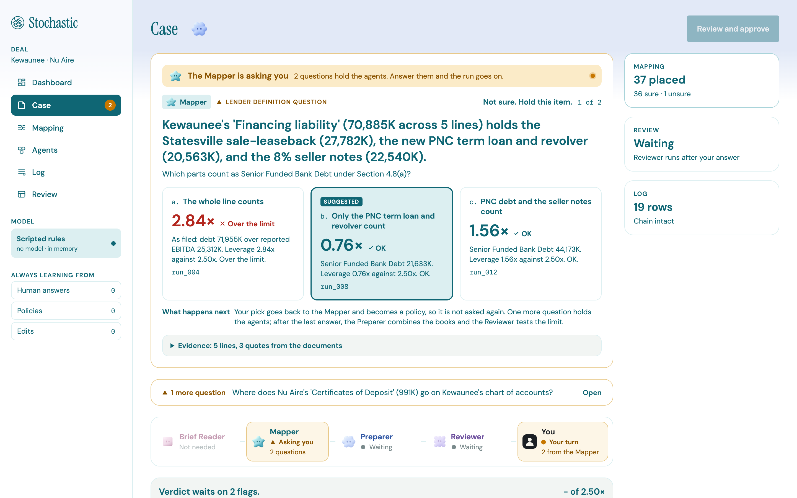
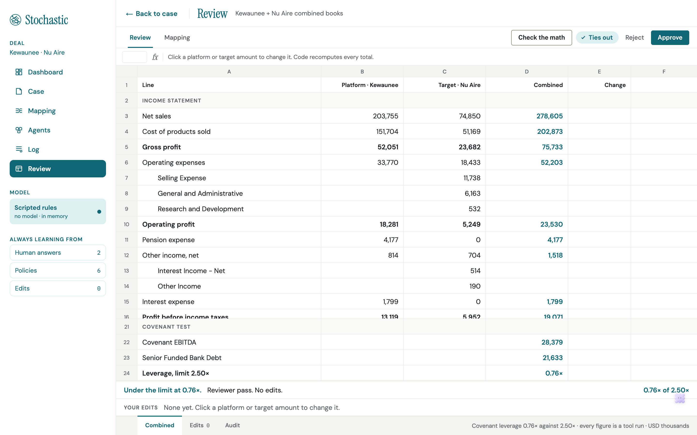
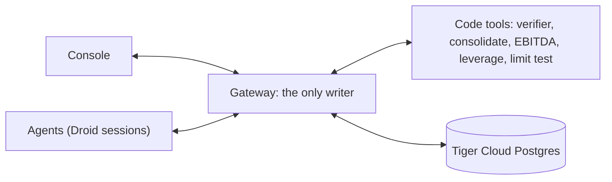
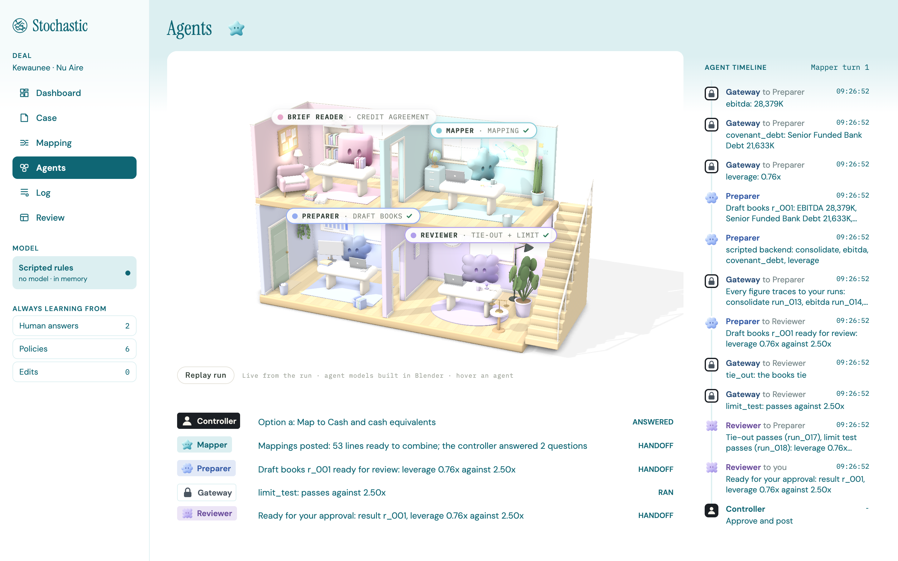

<p align="center">
  
</p>

<p align="center">
  <b>Four AI agents that merge an acquired company's books, ask a human only about the lines that matter, and never do the math themselves.</b><br>
  Built at Cal Hacks 13.0, San Francisco, October 23-25 2026.
</p>

<p align="center">
  
  
  
</p>

## The problem

A private equity firm that runs a buy-and-build strategy buys one company, then keeps bolting smaller ones onto it.
Every add-on runs into the same gate: the lender.
The credit agreement caps how much debt the combined company can carry for every dollar of EBITDA, and someone has to prove the merged books stay under that line before the next deal closes.

Today that is a spreadsheet.
Someone maps every line of the new company onto the platform's chart of accounts by hand, rebuilds the combined numbers, adjusts EBITDA the way the lawyers defined it, and builds the lender's compliance pack.
One line mapped the wrong way flows into every number after it, and nobody notices until the lender does. [inferred]

## Research

We compared three users (a PE portfolio controller after an add-on, a seller-side finance lead, and a sell-side banker) and picked the first.
Full notes, with sources, are in [`docs/research/ma-workflow-research.md`](docs/research/ma-workflow-research.md).

- **It is slow.** One vendor playbook puts a full integration at about 12 weeks, with mapping alone taking weeks 3-4. [self-reported, Aleph]
- **It has a deadline.** Private credit covenants are usually tested quarterly, with the compliance certificate due 45 to 60 days after quarter end. [self-reported, Aleph]
- **It is bespoke.** Each credit agreement defines EBITDA and debt in its own words, so the test cannot be a generic template. [inferred from filings and law-firm commentary]
- **The failures are quiet.** Unmapped accounts drop out of totals, EBITDA is defined differently across documents, and the mapping logic lives in one person's head. [self-reported, Aleph and Keboola]
- **The gap.** FP&A and consolidation tools (Aleph, OneStream, Planful, Datarails) cover the books, but we found none that reads the credit agreement and ties the mapped books to the lender's test. [inferred, limited search]
- **The output can be checked.** Combined totals must tie to the mapped books, and leverage is arithmetic on a defined formula, which suits agents with a code verifier.

## What it does

You drop in two sets of financial statements and the credit agreement.
The agents read the agreement, map every line, combine the books, and test leverage against the lender's limit.
They stop only on the lines that are genuinely unclear, and show what each answer would do to the result.

The demo deal is real: Kewaunee Scientific buying Nu Aire, closed November 1 2024, for $55M. [verified]
Kewaunee's balance sheet has one line called "Financing liability" that mixes a sale-leaseback, a new bank loan, and seller notes.
The agreement's definition of debt excludes the lease and the subordinated notes, so the Mapper does not guess.
It asks:

<p align="center">
  
</p>

Same company, same day, and the answer flips between 2.84x (over the 2.50x limit) and 0.76x (plenty of room for another deal) depending on one line.
That is the line a human should decide, and the only kind Stochastic asks about.
Every figure on each option came from a code tool run, shown by its run id.

The controller then reviews the combined books, edits any figure with a reason, and approves.
Code recomputes every total.

<p align="center">
  
</p>

Then it remembers.
Each answer becomes a policy, and the next run applies it instead of asking again.
One full deal on Claude Haiku 5.5 cost 11,942 Factory credits, and the second deal, with memory kept, cost 7,291. [verified: run log in `docs/agents.md`]

## Tech stack

| Layer | Tech |
| --- | --- |
| Agents | Factory Droid SDK (`droid-sdk[mcp]`), Claude Haiku 5.5 and Sonnet 5.5, with Anthropic API and scripted fallbacks |
| Gateway and tools | Python, FastAPI, Pydantic |
| Store | Postgres and TimescaleDB on Tiger Cloud, or in memory |
| Console | Next.js, React, TypeScript, Tailwind, three.js, designed in Figma |
| Mac app | Electron |
| Tests | pytest, Playwright (browser and Mac app) |



**The model never produces a number.**
Agents decide which tool to call and how to read a messy line, and code does the arithmetic.
The gateway refuses any number that no tool run produced, and it is the only thing that writes to the record.
Every action lands in a hash-chained audit log, so nothing can be quietly rewritten.

**Factory Droid.**
Each role has one persistent Droid session, resumed by id across deals, which is how the agents keep their memory ([`droid_backend.py`](backend/app/agents/backends/droid_backend.py)).
Tools are served through Droid's in-process MCP server, and `restrict_tools` gives each role only its own slice, so no agent can reach a shell or the file system.
Answers are parsed into a Pydantic type, and if the gateway refuses one, the runner calls `Session.rewind` so the bad answer is not left in memory.

**Tiger Data.**
The record, the audit log, and the agents' memory live in Postgres on Tiger Cloud.
The audit log is a TimescaleDB hypertable that refuses edits, and each flag's what-ifs run in a zero-copy fork of the ledger.

## The agents

Each agent maps to a person on a real finance team, and each one has a short list of things it is never allowed to do.
Agents never talk to each other: a plain-code job runner moves work from one to the next.

<p align="center">
  
</p>

| | Agent | The real job | Tools | Never |
| --- | --- | --- | --- | --- |
|  | **Brief Reader** | Credit analyst | `get_section`, `get_definition` | Computes a number, fills a field without a quote, or approves its own Brief |
|  | **Mapper** | Staff accountant | none | Guesses a low-confidence match or an unclear tag |
|  | **Preparer** | Senior accountant | `consolidate`, `ebitda`, `covenant_debt`, `leverage` | Computes a number itself, or approves its own draft |
|  | **Reviewer** | Reviewer | `tie_out`, `limit_test`, `leverage` | Changes the draft |

The Brief Reader is the one we trust least, so it gets checked hardest.
The gateway refuses a quote that is not in the agreement, and a code verifier checks every field against it (22 checks on the demo deal) before mapping can start.

## What is real, and what is not

- The gateway, the math, the verifier, and the audit log are real, and the tests run on the real filing figures.
- The on-stage demo replays a recorded live Droid run (Mapper 33 of 33 against the answer key), so it never depends on conference WiFi. The sidebar always says which backend produced what you see.
- Public filings give statement lines, not trial balances, so the demo maps statement lines.
- The rent deduction and zero transaction costs in covenant EBITDA are inferred, not filed. The combined table has no purchase accounting, and the two fiscal years differ.
- Cut for the weekend: purchase accounting, intercompany eliminations, login, the trailing-twelve-month test period, and a live SEC call.
- No practitioner has checked our assumptions yet. The output is a limit check that a human approves, not advice.

## Running it

```sh
cp .env.example .env        # AGENT_BACKEND=scripted needs no keys

cd backend
uv venv --python 3.12 .venv
uv pip install -p .venv/bin/python fastapi "uvicorn[standard]" pydantic pytest httpx python-dotenv python-multipart anthropic "droid-sdk[mcp]" "psycopg[binary]" openpyxl
.venv/bin/python -m pytest -q
.venv/bin/uvicorn app.main:app --port 8000 --reload

cd frontend && npm install && npm run dev     # http://localhost:3000
cd e2e && npm ci && npm run e2e               # browser and Mac app, no live model
```

The Droid backend needs the `droid` CLI on PATH: `curl -fsSL https://app.factory.ai/cli | sh`.
Start with [`docs/STOCHASTIC.md`](docs/STOCHASTIC.md) for features, architecture, and scope, and [`docs/agents.md`](docs/agents.md) for the agent layer.

## Team

Cayden Hutcheson · Tri Nguyen · Eric Lee · Josie Sauceda
