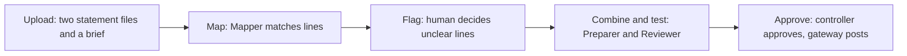
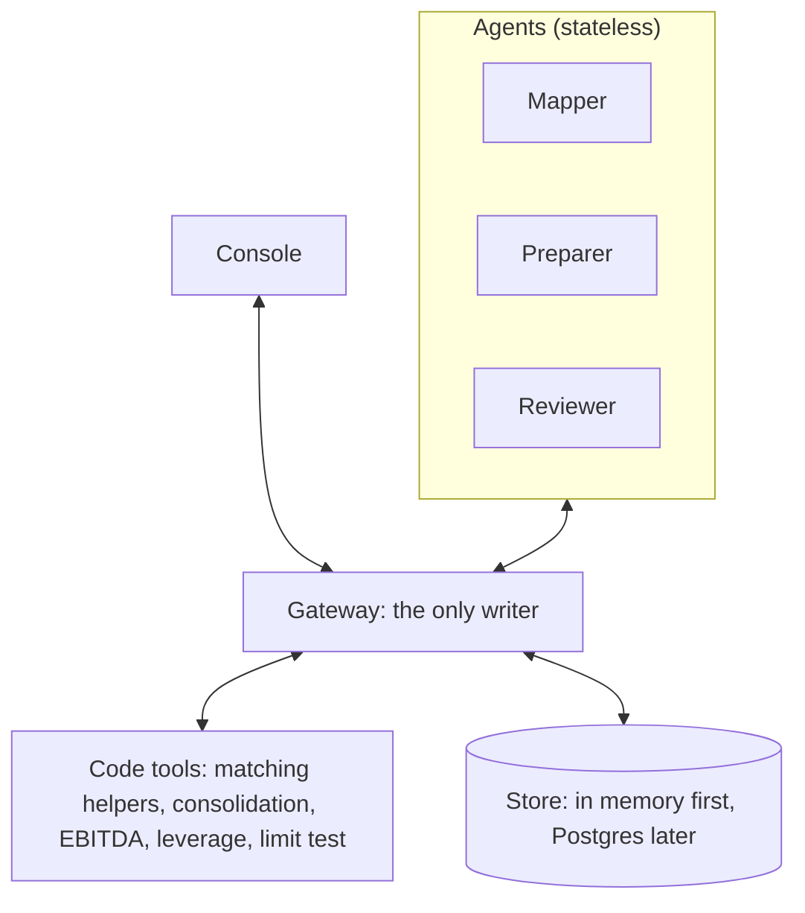

# Stochastic

**Merge an acquired company's books into the platform's books, flag the unclear lines for a human, and check the combined leverage against the lender's limit.**
Stochastic is built for private equity buy-and-build firms that keep buying add-on companies.
Three small AI agents do the repeatable work, code does all the math, and a human controller approves.

Built at Cal Hacks 13.0 (Oct 23-25, 2026, San Francisco) for the Hyphenate track, "The Hyphenated Enterprise: Autonomous Systems for Finance".

| | |
| --- | --- |
| Status | Early prototype. Figma mockups, a gateway API with tests, and a console exist. They implement an earlier workflow on invented data and are being updated to the workflow below. |
| Visibility | Private. |
| Team | UTSA, four people. |
| Start here | [`docs/STOCHASTIC.md`](docs/STOCHASTIC.md), the reference for features, architecture, and scope. |
| Who builds what | [`docs/TASKS.md`](docs/TASKS.md). |

The backend gateway and the console currently implement an earlier workflow on invented data.
They will be updated to the new workflow, as set out in `docs/TASKS.md`.

An earlier idea was one all-in-one platform for any corporate-finance special situation.
It is archived as roadmap in `docs/planning-notes.md` and `docs/research/`.
It is not built, and the product is the integration workflow in this file.

## The problem

A PE firm that buys add-on companies repeatedly has a gate on each new deal.
The lender's agreement sets limits, such as a maximum debt-to-EBITDA ratio.
The lender tests these limits on the combined company.
So the next deal depends on how fast and how correctly the team can combine the books.

Today a finance team does this by hand.
They pull trial balances, map each account of the new company to the platform's chart of accounts in a spreadsheet, build the combined numbers, adjust EBITDA, and prepare the lender's compliance pack.
One vendor playbook puts a full integration at about 12 weeks. [self-reported, Aleph]
Errors in the mapping flow silently into every later number. [inferred]

## What Stochastic does

1. **Maps** each line of the target company to a line of the platform's chart, with a confidence and a short reason.
2. **Flags** only the unclear lines for a human, with both options and the effect on the result.
3. **Combines** the books in code: platform, target, and total, with intercompany amounts removed and EBITDA adjusted.
4. **Tests** combined leverage against the lender's limit, using the covenant's own definitions of debt and EBITDA.
5. **Checks** the work with a reviewer agent, and a human controller approves. The agent that prepares a result cannot approve it.
6. **Logs** every action in an audit log, and each row is chained to the row before it.

## How it works

The workflow has five steps.
The user sees one screen with a flag card, a small combined table, and one verdict line.



The system has four parts.



Agents never talk to each other.
A job runner, which is code and not a model, moves work items from one agent to the next.
The console talks only to the gateway.

The agent layer uses one function, `run_agent(role, item)`, with two backends. [inferred]
The Anthropic API is the real path and the stage fallback.
The Factory Droid Python SDK runs the agents that we show as built with Droid.
An `AGENT_BACKEND` setting switches between them, and a recorded run is the last fallback.

### Design rules

- **Code does the math.** The model never produces a number.
- **Only the gateway writes.** An agent cannot change a record or approve its own work.
- **Use the covenant's own definitions.** A naive and a covenant leverage figure can differ a lot.
- **A tie-out check runs on every combined table.** The parts must add to the total.
- **Unsure means ask.** Precision comes before recall, so an unsure mapping becomes a flag.
- **Nothing is deleted.** A reversal is a new item linked to the original.

## The three agents

Each agent is stateless.
It receives one work item with all its inputs, returns one typed result, and keeps no memory.

| Agent | Real-team role | Gets | Returns | Never |
| --- | --- | --- | --- | --- |
| Mapper | Staff accountant | One company's lines, the platform's chart, and the covenant definitions from the brief | A mapping with confidence and reasons, a covenant tag for each line (debt, not debt, or unclear), and a list of flags | Guesses a low-confidence match or an unclear tag |
| Preparer | Senior accountant | Both mapped books and the approved flags | The draft combined table and the leverage figure, from tool calls | Computes a number itself, or approves its own draft |
| Reviewer | Reviewer | The draft and the limit | Pass or needs-attention, with reasons | Changes the draft |

The human controller approves flagged lines and the final result.

## The demo

The proof deal is Kewaunee Scientific buying Nu Aire, closed 2024-11-01, for $55M. [verified]
Kewaunee is the platform. Nu Aire is the target.
The data comes from public filings: Nu Aire's audited statements, Kewaunee's pro forma statements with a note that maps Nu Aire's lines, and the PNC credit agreement.
Public filings give statement lines, not trial balances, so the demo maps statement lines.

**The one flag** is real: Kewaunee's "Financing liability" line.
It holds a sale-leaseback of the Statesville property and, after the deal, the new acquisition financing. [verified]
The credit agreement's senior funded bank debt excludes the capital lease on that property and the seller notes.
So the agent asks the controller which part of the line is covenant debt.
The answer may change the leverage result. [inferred: not computed yet]

**The one screen** has a flag card with Approve and Change, a combined table of about ten rows, and one verdict line that shows combined leverage against the 2.50x limit.
The audit log is a small link.

Pitch time is 1:30, and the live demo is 0:30.
The agent messages in the demo are hardcoded or recorded.
The gateway, the math, and the audit log are real.

## MVP scope

**Must have**
1. The two input files and the brief for the Kewaunee and Nu Aire deal.
2. The Mapper, with a typed output, running through `run_agent`.
3. Consolidation, EBITDA, and leverage tools, with tests that use the real figures.
4. The gateway with work-item states, maker-checker, and the audit log.
5. The Preparer and the Reviewer (hardcoded text is fine, but the tool calls are real).
6. The console screen: flag card, combined table, verdict line.
7. A recorded run and a backend switch.

**Should have**
- A live Droid-backed agent call in the demo.
- An answer-key score for the mapping.
- A second flag, such as the seller notes.
- Postgres on Tiger Cloud in place of the memory store, and a fork to compare two answers to the flag.
- A downloadable draft compliance certificate.

**Cut for the weekend**
- Purchase accounting beyond a "provisional" label.
- Intercompany schedules and eliminations beyond one seeded example.
- Other situations, other deals, arbitrary uploads, accounts, login, mobile.
- Plan search, Monte Carlo, and rejection-to-policy (these belong to the earlier framing).
- A live SEC call on stage, and a staged denied-action demo.

## Tech stack (proposed)

| Layer | Choice |
| --- | --- |
| Frontend | Next.js, React, TypeScript, Tailwind (the console) |
| Backend | Python, FastAPI (gateway, tools, tests) |
| Agents | Python, `run_agent(role, item)`. Anthropic API by default, Factory Droid Python SDK as the second backend |
| Store | In memory first. Postgres on Tiger Cloud is optional |
| Models | Claude through the Anthropic API. Droid model access is unconfirmed |
| Keys | `FACTORY_API_KEY` and the Anthropic key live in `.env`, which git ignores |

## Repository layout

```
stochastic/
  README.md            This file
  CLAUDE.md            Instructions for Claude Code
  .env.example         Names of the settings the app will need (no secrets)
  docs/
    STOCHASTIC.md      Reference: features, architecture, scope
    TASKS.md           Who builds what
    architecture/      Parts, agents and work items, gateway and API, data model
    design/            Figma links, tokens, and UI rules
    research/          Sourced research, including the deal and workflow files
    sponsors/          Sponsor and track research
    diagrams/          PDFs from the first framing (stale)
    planning-notes.md  Archive from earlier framings
    hyphenate-workshop.md
  backend/             FastAPI gateway, in-memory store, deal math, tests (earlier workflow)
  frontend/            Console: Next.js, Tailwind (earlier workflow)
  evals/               Answer key and scoring (planned)
  data/                Cached public filings (git-ignored)
  scripts/             Helper scripts (planned)
```

## Getting started

Run the backend and the console in two terminals.

```
cd backend
uv venv --python 3.12 .venv
uv pip install -p .venv/bin/python fastapi "uvicorn[standard]" pydantic pytest httpx
.venv/bin/python -m pytest                                  # trust-rule tests
.venv/bin/uvicorn app.main:app --port 8000 --reload

cd frontend
npm install
npm run dev                                                 # http://localhost:3000
```

The console reads `NEXT_PUBLIC_API_URL` (default `http://localhost:8000`).
Call `POST /dev/reset` on the API to reseed the demo data.
The demo data is still the earlier invented data: an invented company, invented numbers, and invented quotes.

## Documentation

| File | What it holds |
| --- | --- |
| [`docs/STOCHASTIC.md`](docs/STOCHASTIC.md) | The reference. Read it first. |
| [`docs/TASKS.md`](docs/TASKS.md) | Who builds what, the shared contract, and the order of work |
| [`docs/tasks/`](docs/tasks) | One task file per person, with branches and owned folders |
| [`docs/demo-script.md`](docs/demo-script.md) | The 2:00 plan, the 30-second demo beat by beat, failure plan, and judge Q&A |
| [`docs/glossary.md`](docs/glossary.md) | Finance terms in plain language, with examples from the Kewaunee deal |
| [`docs/decisions.md`](docs/decisions.md) | The dated decision log: how we got from three framings to this one |
| [`docs/architecture/`](docs/architecture) | Parts, agents and work items, gateway and API, data model, repo structure |
| [`docs/research/ma-workflow-research.md`](docs/research/ma-workflow-research.md) | The three M&A users, pain, time, and existing products |
| [`docs/research/post-close-deliverables.md`](docs/research/post-close-deliverables.md) | What a PE finance team gets after an add-on closes |
| [`docs/research/real-deal-candidates.md`](docs/research/real-deal-candidates.md) | The real deal, with EDGAR links |
| [`docs/research/agent-framework-options.md`](docs/research/agent-framework-options.md) | Droid, ADK, Anthropic API, and others |
| [`docs/hyphenate-workshop.md`](docs/hyphenate-workshop.md) | The Hyphenate workshop blueprint and the gaps |
| [`docs/sponsors/`](docs/sponsors) | Sponsor research for Hyphenate, Tiger Data, Microsoft, Factory, and Mana |
| [`docs/diagrams/`](docs/diagrams) | PDFs from the first framing. Stale. |

## A worked example of the flag

This example uses only facts from the filings. The ratios are not computed yet. [inferred where marked]

1. Kewaunee's balance sheet has one line, "Financing liability". At 2024-10-31 it was $750K current plus $27,032K long-term. [verified]
2. The 10-Q says the line comes from a sale-leaseback of the Statesville property, carried at $27,782K. [verified]
3. After the deal, the pro forma balance sheet adds $3,000K current and $40,103K long-term to the same line for the new acquisition financing. [verified]
4. The credit agreement defines Senior Funded Bank Debt. It excludes the capital lease on that property and it excludes the subordinated seller notes. [verified]
5. So the Mapper cannot say which part of the line is covenant debt. It raises a flag instead of guessing.
6. The controller answers. The Preparer calls the leverage tool with that answer. The Reviewer tests the result against 2.50x.
7. A naive ratio, which adds the whole line, and the covenant ratio can differ a lot. [inferred: Tri computes both first]

## Team and branches

| Person | Area | Branch | Task file |
| --- | --- | --- | --- |
| Cayden | Agents, gateway, demo | `cayden/agents` | [`docs/tasks/cayden.md`](docs/tasks/cayden.md) |
| Josie | UI and UX only | `josie/design` | [`docs/tasks/josie.md`](docs/tasks/josie.md) |
| Eric | Data, input files, answer key, Devpost draft | `eric/data` | [`docs/tasks/eric.md`](docs/tasks/eric.md) |
| Tri | Math tools, tests, API | `tri/tools` | [`docs/tasks/tri.md`](docs/tasks/tri.md) |

Each person edits only the folders they own. The rules for parallel work are in [`docs/tasks/README.md`](docs/tasks/README.md).
Cayden owns the shared data contract in `backend/app/core/models.py`.

## Open questions

- Does PE add-on integration count as a corner of a finance team for Hyphenate? Ask at the Friday 7pm workshop.
- Which part of Kewaunee's financing liability counts as covenant debt? A practitioner should confirm.
- Can Droid run Claude models on our key?
- Does the SEC allow us to redistribute the cached filings?

The full list is in section 18 of `docs/STOCHASTIC.md`.

## Honesty notes

- Claims in the docs are tagged verified or inferred. No practitioner has checked the user assumptions.
- The demo is a reconstruction from public filings. It does not show the internal views of the lender or the company.
- The agent messages in the demo are hardcoded or recorded. The gateway, the math, and the audit log are real.
- The output is a mapped, combined set of books and a limit check that a human approves. It is not advice.
- Other situations are roadmap, not built.
- Sponsor and vendor numbers are self-reported.

## License

None yet. This repository is private, and all rights are reserved until the team decides.

## Acknowledgments

Travel supported by the UTSA College of AI, Cyber and Computing (CAICC) Student Success Center.
