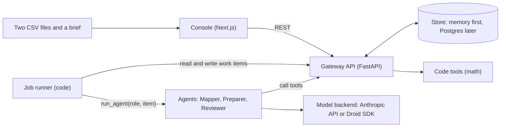

# Architecture

Status: design proposal, rewritten 2026-10-23 after the second reframe.
The product reference is `../STOCHASTIC.md`. If this folder and that file disagree, that file is correct.
This folder says how we build it.
Claims are tagged [inferred] when they are our design choice and not a fact from a source.
An earlier framing used six agents, plan search, Monte Carlo, a clause reader, a quote validator, vector tables, and six escalation points.
That design is archived in `../planning-notes.md` and `../research/`. It is not part of this design.

## Goals

- Keep the system small enough to build in one weekend.
- Make the trust rules true in code: code does the math, only the gateway writes, unsure means ask.
- Run one deal end to end (Kewaunee buys Nu Aire) before adding anything else.

## Parts

| Part | Tech | Job |
| --- | --- | --- |
| People and files | Two statement files (CSV) and a short brief | The input. The brief states the lender's limit. |
| Console | Next.js, React, TypeScript, Tailwind | One screen: flag card, combined table, verdict line. A small link opens the audit log. |
| Gateway API | Python, FastAPI | The only writer. Checks the actor, the permission, the state change, and maker-checker. Writes the audit log. |
| Agents | Python, `run_agent(role, item)` | Three small stateless agents: Mapper, Preparer, Reviewer. |
| Job runner | Python, plain code | Moves work items from one agent to the next. It is not a model. |
| Code tools | Python | All the math: line matching helpers, consolidation, EBITDA, leverage, limit test. They have no write access. |
| Store | In memory first, Postgres on Tiger Cloud later | Holds the record, the work items, and the audit log. |

## System diagram

The agents do not talk to each other.
They do not touch the store.
They call tools through the gateway, and the gateway runs the tool code and records the run id.
The console talks only to the gateway.

## Request flow

1. The user adds the platform file, the target file, and the brief. The gateway stores the source lines and creates the deal.
2. The job runner makes a Mapper work item for the target. The Mapper returns a mapping with confidence and reasons, and a list of flags.
3. The gateway stores the mapping. Each flagged line becomes a work item in state NEEDS_INFO.
4. The console shows a flag card. The controller approves the mapping or changes it. The gateway records the answer.
5. When no flag is open, the runner makes a Preparer work item. The Preparer calls code tools and returns the draft combined table and the leverage figure.
6. The runner makes a Reviewer work item. The Reviewer checks that the totals tie and tests leverage against the limit. It returns pass or needs-attention.
7. If the verdict is needs-attention, the item goes back to the human. If it is pass, the console shows the verdict line.
8. The controller approves the result. The gateway moves it to POSTED and writes the log.

## Design choices

- **Small stateless agents.** Each agent gets one work item with all its inputs and returns one typed result. State lives in the store. [inferred]
- **A plain job runner.** The work-item table is the queue. The runner is code, so there is no Redis, Kafka, or Celery. [inferred]
- **One function, two backends.** `run_agent(role, item)` runs on the Anthropic API (the real path and the stage fallback) or on the Factory Droid Python SDK. `AGENT_BACKEND` switches. A recorded run is the last fallback. [inferred, from `../research/agent-framework-options.md`]
- **No agent-to-agent protocol.** The work-item queue is the only coordination point. [inferred]
- **Deterministic tools.** The model never produces a number. Every number carries a run id from the math code.
- **Maker-checker.** The agent that prepares a result cannot approve it. A reviewer agent checks it, and a human approves it.
- **REST plus Server-Sent Events.** The console gets live updates from one SSE stream per deal. Already built for the audit log. [inferred]
- **Memory store first.** The first prototype keeps the tables in memory. Postgres on Tiger Cloud is optional and replaces the store without changing the API. [inferred]

## Deployment (proposed)

- Local: run the FastAPI app with uvicorn and the Next.js app with npm. The Droid backend needs the `droid` CLI on the same machine, because the Python SDK runs a local subprocess.
- Demo: the API and the console run on one laptop or one host. Postgres on Tiger Cloud is optional. [inferred]
- Cached public filings are stored on disk in `data/` and are never fetched live on stage. They stay out of git.
- Keys such as `ANTHROPIC_API_KEY` and `FACTORY_API_KEY` live in `.env`. Git ignores it.

## Documents in this folder

| File | What it holds |
| --- | --- |
| `agents-and-work-items.md` | Work-item types, the state diagram, the three agent contracts, the job runner, and the two human moments |
| `gateway-and-api.md` | Actors, the permission matrix, the checks, the routes, the JSON shapes, and `run_agent` |
| `data-model.md` | The tables, the rules, how a result traces to its source lines, and the stores |
| `repo-structure.md` | The folder map and the conventions for code |
