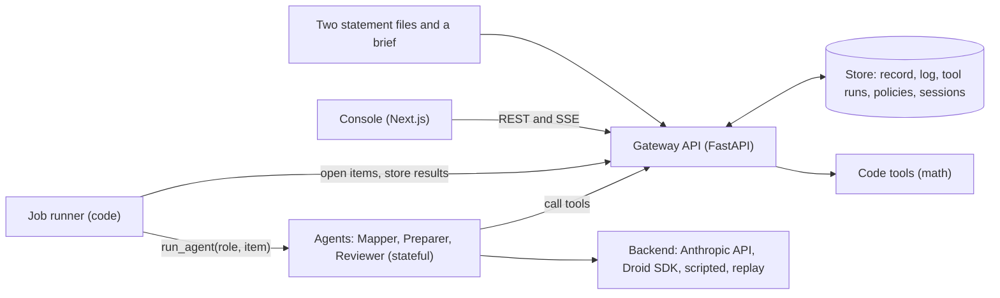

# Architecture

Status: describes the code as of 2026-10-24.
The product reference is `../STOCHASTIC.md`. If this folder and that file disagree, that file is correct.

## Goals

- Keep the system small enough to build in one weekend.
- Make the trust rules true in code: code does the math, only the gateway writes, unsure means ask.
- Run one deal end to end (Kewaunee buys Nu Aire) before adding anything else.
- Agents are stateful. What the controller teaches them is kept and applied next time.

## Parts

| Part | Tech | Job |
| --- | --- | --- |
| People and files | Two statement files and a brief, loaded by `backend/app/db/fixtures/kewaunee.py` | The input. The brief states the lender's limit and definitions. |
| Console | Next.js, React, TypeScript, Tailwind | One screen: flag card, combined table, verdict line. A small link opens the audit log. |
| Gateway API | Python, FastAPI | The only writer. Checks the actor, the permission, the state change, maker-checker, and the run ids. Writes the audit log and the agents' memory. |
| Agents | Python, `run_agent(role, item)` | Three stateful agents: Mapper, Preparer, Reviewer. Four backends: anthropic, droid, scripted, replay. A fourth, the Brief Reader, is planned (D20, `brief-reader.md`). |
| Job runner | Python, plain code | Moves work items from one agent to the next. It is not a model. |
| Code tools | Python, `backend/app/tools/finance.py` | All the math: consolidation, tie-out, EBITDA, covenant debt, leverage, limit test. No write access. |
| Store | In memory, written through to Postgres on Tiger Cloud with `STORE=postgres` | Holds the record, the work items, the tool runs, the audit log, the policies, and the sessions. The audit log is an append-only TimescaleDB hypertable, and a restart loads everything back (`backend/app/db/postgres.py`). |

## System diagram

## Request flow

1. The fixture loads the platform lines, the target lines, and the brief. The gateway creates the deal.
2. `POST /deals/{id}/run`. The runner opens `map_lines`. The Mapper (with its policies) returns mappings, tags, and flag proposals.
3. The gateway stores the mappings and tags, and opens a flag per proposal. For each option it runs the tools as a what-if and writes the effect on the option.
4. The console shows the flag card. The controller answers. The gateway applies the tags or the mapping, writes a policy, and posts the flag. The run continues.
5. The Preparer calls `consolidate`, `ebitda`, `covenant_debt`, and `leverage` through the gateway and returns the draft with the run ids.
6. The Reviewer calls `tie_out` and `limit_test` and returns pass or needs-attention. The gateway opens `approve_result`.
7. The controller approves. The gateway posts and the deal stage is `posted`.
8. Run again after a reset: the Mapper applies the policies and asks nothing.

## Documents in this folder

| File | What it holds |
| --- | --- |
| `agents-and-work-items.md` | Work-item types, states, the three agent contracts, the job runner, memory, the two human moments |
| `gateway-and-api.md` | Actors, permissions, checks, routes, the case shape, `run_agent` |
| `data-model.md` | The tables, the audit chain, how a number traces to its source lines |
| `repo-structure.md` | The folder map and the conventions for code |
| `brief-reader.md` | The planned fourth agent: reading the credit agreement into the brief, the gateway's quote checks, brief approval, stages (D20) |
