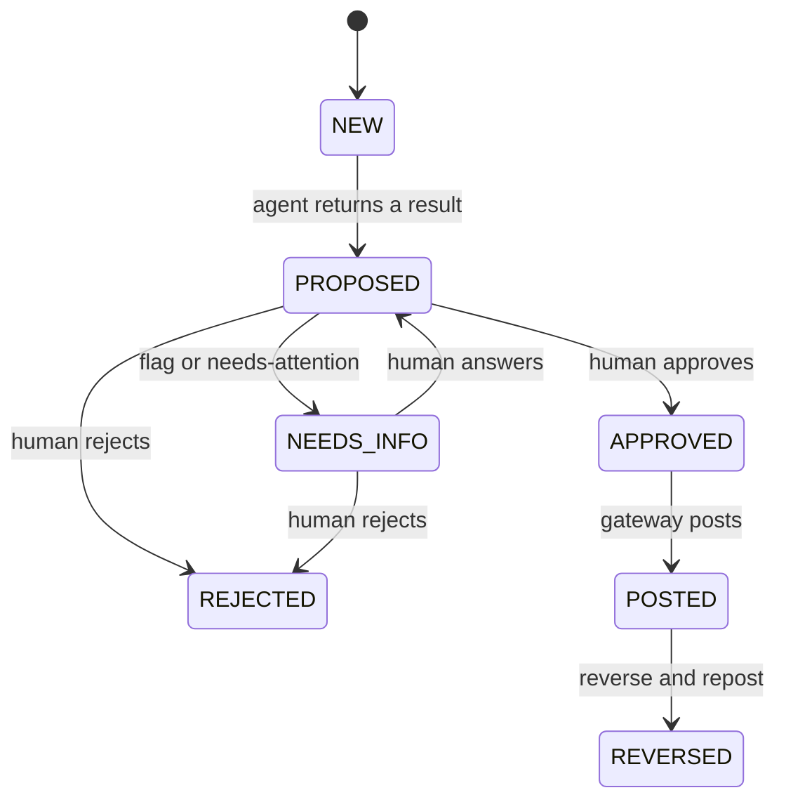

# Agents and work items

Agents never chat with each other.
They receive one work item and return one typed result.
The gateway stores the result.
Everything below is a design proposal [inferred], except where a source file says otherwise.
The earlier six-agent design, its escalation points E1 to E6, and its work-item types are archived. They are not used here.

## Work-item types

| Type | Made by | Meaning |
| --- | --- | --- |
| `map_lines` | Job runner | Map one company's lines to the platform chart. The Mapper handles it. |
| `flag` | Gateway, from the Mapper's flags | One line is unclear. A human must choose. |
| `prepare_result` | Job runner | Build the draft combined table and the leverage figure. The Preparer handles it. |
| `review_result` | Job runner | Check the draft. The Reviewer handles it. |
| `approve_result` | Gateway | The controller approves the final result before it posts. |

## States

A work item has one state at a time.
These states are already in `backend/app/core/models.py`.



A forbidden action is DENIED. It is not a state.
The gateway does not apply a denied action, and it writes a row to the audit log.
The preparer of an item cannot approve it.
Only the gateway moves an item to POSTED.
A reversal is a new item linked to the original. The system never deletes.

## The three agent contracts

Each agent is stateless.
It gets one work item with all its inputs.
It returns one typed result and keeps no memory.
It can call only the tools it was given, and only through the gateway.
The gateway checks the result with its own Pydantic model before it stores anything.

### Mapper (staff accountant)

Input:

```python
class MapperInput(BaseModel):
    company: str                    # the target
    lines: list[SourceLine]         # the target's lines
    platform_chart: list[SourceLine]  # the platform's lines to map onto
```

Output:

```python
class MapperOutput(BaseModel):
    mappings: list[Mapping]         # target_line, platform_line, confidence, reason, flagged
    flags: list[str]                # target lines the Mapper could not place with confidence
```

Tools: line matching helpers.
Never: guesses a low-confidence match. Precision before recall, so an unsure line becomes a flag.

### Preparer (senior accountant)

Input:

```python
class PreparerInput(BaseModel):
    platform_lines: list[SourceLine]
    target_lines: list[SourceLine]
    mappings: list[Mapping]         # all approved, including the answers to flags
    brief: Brief                    # the limit and the covenant definitions
```

Output:

```python
class PreparerOutput(BaseModel):
    rows: list[ResultRow]           # platform, target, combined, with a run id each
    leverage: float
    limit: float
    run_ids: list[str]              # from the math tools
```

Tools: consolidate, remove intercompany, EBITDA, debt, leverage.
Never: computes a number itself, or approves its own draft.

### Reviewer (reviewer)

Input:

```python
class ReviewerInput(BaseModel):
    draft: PreparerOutput
    limit: float
```

Output:

```python
class ReviewerOutput(BaseModel):
    verdict: Literal["pass", "needs_attention"]
    reasons: list[str]              # tie-out error, or limit breach, with the numbers' run ids
```

Tools: tie-out check, limit test.
Never: changes the draft.

The Mapper and the Reviewer run through `run_agent(role, item)`.
The Preparer and the Reviewer may use hardcoded text in the demo, but their tool calls are real. [verified: `../STOCHASTIC.md`, section 13]

## The job runner

The runner is plain code, not a model.
It reads work items from the gateway and moves them from one agent to the next:

1. A new deal creates a `map_lines` item.
2. When the Mapper's result is stored and no `flag` is open, it creates a `prepare_result` item.
3. When the Preparer's result is stored, it creates a `review_result` item.
4. When the Reviewer's verdict is stored, the gateway creates `approve_result` for the human, or returns the item to NEEDS_INFO on needs-attention.

The runner holds no state of its own.
It can crash and restart, and it will find the next item in the store.

## Stateless and replicable

An agent is a role: a system prompt, a tool list, and a typed result.
It has no memory and no local files.
So the same definition can run once per company, or once per batch of lines, in parallel.
Two runs on the same item can be compared, because the item holds all the inputs. [inferred]

## The two human moments

- **Flag.** A line is unclear. The console shows both options and the effect on the result. The controller chooses.
- **Approval.** The controller approves the combined result before it posts.

If the Reviewer finds a tie-out error or a breach of the limit, the item returns to the human as needs-attention.

## Flag payload

Every flag carries the same fields, so the console shows one card shape.
These fields already exist on `WorkItem`.

- `question`: one sentence.
- `evidence`: the source line, with its filing reference.
- `options`: two or three answers, each with its effect on the result.
- `default`: the option the agent suggests, if any.
