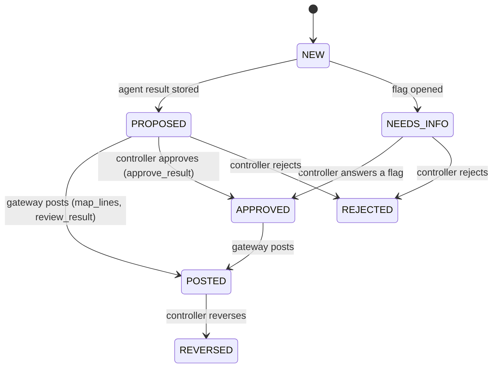

# Agents and work items

Agents never chat with each other.
Each agent receives one work item and returns one typed result through the gateway.
Agents are stateful: each role keeps a session and the Mapper applies the policies the controller taught it.
The state lives in the store, so it survives a restart, and a second deal starts with what the first one taught.
This file describes the code in `backend/app/agents/` as of 2026-10-24.

## Work-item types

| Type | Opened by | Meaning |
| --- | --- | --- |
| `map_lines` | Job runner (through the gateway) | Map the target's lines to the platform's chart and tag the balance sheet lines. The Mapper handles it. |
| `flag` | Gateway, from the Mapper's flag proposals | One line is unclear. The controller must choose. Each option carries an effect computed by the tools. |
| `prepare_result` | Job runner | Build the draft combined table and the leverage figure. The Preparer handles it. |
| `review_result` | Job runner | Check the draft. The Reviewer handles it. |
| `approve_result` | Gateway, after the review | The controller approves the result before it posts. It is proposed by the Preparer, so maker-checker applies. |
| `reverse:<type>` | Gateway, on a reversal | A new item linked to the original. |
| `draft_brief` (planned, D20) | Job runner, before `map_lines`, when the deal has an agreement and no approved brief | Draft the brief from the credit agreement. The Brief Reader handles it, and the controller approves it. See `brief-reader.md`. |

## States

A forbidden action is DENIED.
It is not a state.
The gateway does not apply a denied action, and it writes a row to the audit log.
The controller's answer to a flag is the approval of that flag, so an answered flag posts at once.

## The three agent contracts

Types are in `backend/app/core/models.py`.

### Mapper (staff accountant)

Input: `MapperInput` with the target lines, the platform lines, the brief, the policies it learned, and its session.
Output: `MapperOutput` with `mappings` (target line id, platform line, confidence, reason, policy id), `tags` (a covenant tag for every balance sheet line), and `flags` (a question, evidence, options, and the tags or platform line each option applies).
Tools: none.
It only proposes.
Never: guesses a low-confidence match or an unclear tag.
Precision before recall.

### Preparer (senior accountant)

Input: `PreparerInput` with both companies' lines, the usable mappings, the brief, and its session.
Output: `PreparerOutput` with rows (each with the consolidate run id), ebitda, debt, leverage, limit, run ids.
Tools: `consolidate`, `ebitda`, `covenant_debt`, `leverage`.
Never: types a number of its own.
The gateway refuses a value that no run produced.

### Reviewer

Input: `ReviewerInput` with the draft rows, figures, run ids, and its session.
Output: `ReviewerOutput` with `pass` or `needs_attention`, reasons, and the run ids of its checks.
Tools: `tie_out`, `limit_test`, `leverage`.
Never: changes the draft.

## The job runner

`backend/app/agents/jobs.py`, plain code.
`advance(gw, deal_id)` does every step that needs no human, then stops:

1. No `map_lines` yet: open one, run the Mapper, store the mapping.
   The gateway opens a flag per proposal.
2. A flag is open: stop.
   The console shows the flag card.
3. Flags answered and no draft: open `prepare_result`, run the Preparer, store the result.
4. Draft stored and no review: open `review_result`, run the Reviewer, store the verdict.
   The gateway opens `approve_result`.
5. Waiting on the controller: stop.

`POST /deals/{id}/run` calls it.
Answering the last open flag calls it again in the background.
The runner holds no state.
It can run again at any time and finds the next thing to do.

## Memory

- `Policy`: role, kind (`covenant_tag` or `mapping`), the normalized line name, the decision, who approved it, the flag it came from, how many times it was applied.
- `AgentSession`: role, backend, backend session id (Droid resumes it), turns, a short transcript.
- The gateway writes both.
  `GET /agents/memory` reads them.
  `POST /dev/reset` keeps them.
- The demo moment for memory: reset the deal, run again, and the Mapper asks nothing.
  The audit log shows `policy:apply` rows.

## The two human moments

- **Flag.** A line is unclear.
  The console shows the question, the evidence, and the options with their computed effects.
  The controller chooses.
- **Approval.** The controller approves the combined result before it posts.
  The gateway refuses until the Reviewer verdict is pass.
- **Brief approval (planned, D20).** Before mapping, the controller approves the brief the Brief Reader drafted, with a quote for every field.
  Mapping and the covenant tools are refused until then.

If the Reviewer finds a tie-out error or a breach of the limit, `approve_result` opens as NEEDS_INFO with the reasons, and the controller rejects it or reverses a flag.

## Flag payload

Every flag carries the same fields, so the console shows one card shape: `question`, `evidence` (quote and document id), `options` (id, label, effect, run id), `default`, and `payload.kind` (`covenant_tag` or `mapping`) with `payload.line_ids`.
