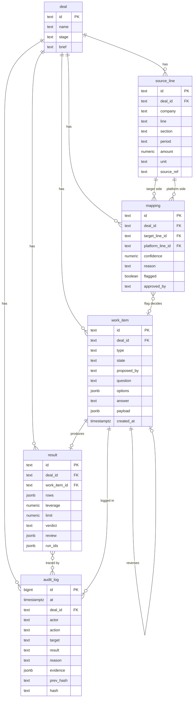

# Data model

Tables hold exact facts.
The rule "vectors find, tables decide" still holds, but the MVP has no vector search and no vector table.
The table names below are a design proposal and can change in the build [inferred].
The tables are `deal`, `source_line`, `mapping`, `work_item`, `result`, `tool_run`, `audit_log`, `policy`, and `agent_session`.
The code is `backend/app/db/memory.py`, `backend/app/db/postgres.py`, and the Pydantic models in `backend/app/core/models.py` (2026-10-25).
The earlier framing had document, chunk, fact, clause, plan, and simulation tables.
They are archived and are not used.

Tags: [verified] means a source file or filing shows it. [inferred] means it is our design judgment.
All amounts in example rows are PLACEHOLDER unless the text says the figure is in `../research/real-deal-candidates.md`.
The example rows use the Kewaunee Scientific and Nu Aire deal.
The deal closed 2024-11-01 for $55M. [verified: `../research/real-deal-candidates.md`]

## 1. Overview



The links in the diagram are logical.
`mapping.work_item` is stored in `work_item.payload` (key `mapping_id`), and `work_item.reverses_id` is a proposed new column, so neither is a plain foreign key in the first design. [inferred]
`audit_log.target` holds the id of a work item, a result, or another record, as text.

## 2. Tables

Types are Postgres types.
The memory store uses the matching Python types.
"Gateway only" means only the gateway writes the table. [verified: `../STOCHASTIC.md`, section 9]

### 2.1 `deal`

One row per add-on deal.
The MVP has one row.

| Column | Type | Constraints | Meaning |
| --- | --- | --- | --- |
| `id` | text | primary key | Example `d_001` |
| `name` | text | not null | Deal name |
| `stage` | text | not null | Where the deal is in the workflow |
| `brief` | text | not null | The lender's limit and the covenant definitions of debt and EBITDA |

Note: the existing `Deal` model in `backend/app/core/models.py` also has a `situation` field from the earlier framing.
Drop it, or keep it as free text. [inferred]

Example row:

| id | name | stage | brief |
| --- | --- | --- | --- |
| `d_001` | Kewaunee Scientific acquires Nu Aire | `awaiting_flag` | Limit 2.50 to 1.00 (PNC Loan Agreement, Section 4.8(a)). Senior Funded Bank Debt excludes seller notes and the capital lease on 2700 West Front Street. Definitions: Ex 10.1. |

The limit and the exclusions in the brief are [verified: `../research/real-deal-candidates.md`].
The stage names are [inferred].

### 2.2 `source_line`

One row per statement line of each company.
Rows are never changed after load.

| Column | Type | Constraints | Meaning |
| --- | --- | --- | --- |
| `id` | text | primary key | Example `sl_014` |
| `deal_id` | text | not null, foreign key to `deal.id` | |
| `company` | text | not null | `Kewaunee` (platform) or `Nu Aire` (target) |
| `line` | text | not null | The line name as filed |
| `section` | text | not null, check in (`income_statement`, `balance_sheet`) | |
| `period` | text | not null | Period end date, such as `2024-09-30` |
| `amount` | numeric(18,2) | not null | In the unit named in `unit` |
| `unit` | text | not null | Example `USD thousands` |
| `source_ref` | text | not null | The filing and exhibit |

Unique key: (`deal_id`, `company`, `section`, `line`, `period`). [inferred]
The shape follows the shared contract in `../TASKS.md`.
The unit is stored with each row because Nu Aire's audited statements show whole dollars ($74,850,302) and Kewaunee's pro forma table shows thousands ($203,755K). [verified: `../research/real-deal-candidates.md`]

Example rows:

| id | company | line | section | period | amount | unit | source_ref |
| --- | --- | --- | --- | --- | --- | --- | --- |
| `sl_001` | Nu Aire | Net revenues | income_statement | 2024-09-30 | 74850302 | USD | 8-K/A Ex 99.1 |
| `sl_002` | Nu Aire | Depreciation and amortization | cash flow note (stored as income_statement) | 2024-09-30 | 1830395 | USD | 8-K/A Ex 99.1 |
| `sl_003` | Kewaunee | Net sales | income_statement | 2024-04-30 | 203755 | USD thousands | 8-K/A Ex 99.2 |
| `sl_004` | Kewaunee | Financing liability, current | balance_sheet | 2024-10-31 | 750 | USD thousands | 10-Q |
| `sl_005` | Kewaunee | Financing liability, long-term | balance_sheet | 2024-10-31 | 27032 | USD thousands | 10-Q |
| `sl_006` | Nu Aire | Accrued Commissions | balance_sheet | 2024-09-30 | PLACEHOLDER | USD | 8-K/A Ex 99.1 |

The amounts in `sl_001` to `sl_005` are in the research file. [verified]
The amount in `sl_006` is not in the research file.
The cash flow figure does not fit the two sections cleanly.
Add a `cash_flow` section if the build needs it. [inferred]

### 2.3 `mapping`

One row per target line.
It says which platform line the target line goes to.

| Column | Type | Constraints | Meaning |
| --- | --- | --- | --- |
| `id` | text | primary key | Example `m_007` |
| `deal_id` | text | not null, foreign key | |
| `target_line_id` | text | not null, foreign key to `source_line.id`, unique | The target line. One mapping per target line. |
| `platform_line_id` | text | foreign key to `source_line.id`, null while unplaced | The platform line it maps to |
| `confidence` | numeric(3,2) | not null, check between 0 and 1 | The Mapper's confidence |
| `reason` | text | not null | A short reason |
| `flagged` | boolean | not null, default false | True if a human must decide |
| `approved_by` | text | null | The human actor who approved a flagged mapping |

Rules:
- A mapping with `flagged` true is not usable until `approved_by` is set. [verified: previous version of this file]
- Check: `flagged` is false or `approved_by` is not null before the Preparer reads it.
  The gateway enforces this, not a database check. [inferred]
- The existing API shape in `gateway-and-api.md` uses `target_line` and `platform_line` as names.
  The table stores ids.
  The API can join them. [inferred]

Example rows:

| id | target line | platform line | confidence | reason | flagged | approved_by |
| --- | --- | --- | --- | --- | --- | --- |
| `m_001` | Accrued Commissions (Nu Aire) | Employee compensation and amounts withheld (Kewaunee) | PLACEHOLDER | Filed in Note 2 as a reclass of $0.9M | false | null |
| `m_002` | Accrued Compensation (Nu Aire) | Other accrued expenses (Kewaunee) | PLACEHOLDER | Filed in Note 2 as a reclass of $0.2M | false | null |
| `m_003` | Interest Income - Net (Nu Aire) | Other income, net (Kewaunee) | PLACEHOLDER | Filed in Note 2 as a reclass of $0.3M | false | null |
| `m_004` | Certificates of Deposit (Nu Aire) | none yet | PLACEHOLDER | No direct Kewaunee line | true | null |
| `m_005` | Financing liability (Kewaunee, platform side) | Financing liability | PLACEHOLDER | One line holds the sale-leaseback and the new acquisition financing | true | null |

The three Note 2 reclasses and the amounts $0.9M, $0.2M, and $0.3M are [verified: `../research/real-deal-candidates.md`].
Note 2 is preliminary and the fiscal years differ, so it is an answer key for shape, not to the dollar. [verified]
Confidence values are not in any source.
They come from the Mapper at run time.
For `m_005` the flagged line is on the platform side.
The model needs a way to flag a platform line that holds two kinds of debt.
A proposed way: the flag work item holds the `source_line` id in its payload, and `mapping` is not used for it. [inferred]

### 2.4 `work_item`

One row per unit of work or human question.
Matches the existing `WorkItem` model, with `escalation` dropped. [verified: `models.py`]

| Column | Type | Constraints | Meaning |
| --- | --- | --- | --- |
| `id` | text | primary key | Example `wi_003` |
| `deal_id` | text | not null, foreign key | |
| `type` | text | not null, check in (`map_lines`, `flag`, `prepare_result`, `review_result`, `approve_result`) | See `agents-and-work-items.md` |
| `state` | text | not null, check in (`NEW`, `PROPOSED`, `NEEDS_INFO`, `APPROVED`, `REJECTED`, `POSTED`, `REVERSED`) | |
| `proposed_by` | text | not null | The actor, such as `agent:mapper` |
| `question` | text | null | For a flag, one sentence |
| `evidence` | jsonb | not null, default `[]` | List of quotes with page and document id |
| `options` | jsonb | not null, default `[]` | List of `{id, label, effect}` |
| `default` | text | null | The option the agent suggests |
| `answer` | text | null | The chosen option id |
| `reject_reason` | text | null | Set on reject |
| `payload` | jsonb | not null, default `{}` | The typed agent result, checked by a Pydantic model |
| `created_at` | timestamptz | not null | |
| `reverses_id` | text | null, foreign key to `work_item.id` | Proposed: the item this one reverses |

The existing model also has an `escalation` field from the earlier framing.
Drop it or leave it null. [verified: `models.py`, `gateway-and-api.md`]
The main text of the previous version listed `evidence` inside the `payload` and not as a column.
The existing model has `evidence` as its own field, so this version keeps it. [verified: `models.py`]

Example row (the flag):

| Field | Value |
| --- | --- |
| id | `wi_003` |
| type | `flag` |
| state | `NEEDS_INFO` |
| proposed_by | `agent:mapper` |
| question | Which part of the Financing liability line is covenant debt? |
| evidence | quote "Financing liability", `source_ref` 10-Q |
| options | `a`: Whole line counts as debt, effect PLACEHOLDER. `b`: Only the acquisition financing counts as debt, effect PLACEHOLDER |
| default | null |
| answer | null |
| payload | `{"source_line_ids": ["sl_004", "sl_005"]}` |

The line holds a sale-leaseback with a $27,782K carrying value, and the pro forma balance sheet adds $3,000K current and $40,103K long-term for the new debt. [verified: `../research/real-deal-candidates.md`]
The effects are not computed yet. [verified: `../STOCHASTIC.md`, section 12]

### 2.5 `result`

One row per combined result that a human can approve.

| Column | Type | Constraints | Meaning |
| --- | --- | --- | --- |
| `id` | text | primary key | Example `r_001` |
| `deal_id` | text | not null, foreign key | |
| `work_item_id` | text | not null, foreign key to `work_item.id` | The `prepare_result` item that made it |
| `rows` | jsonb | not null | List of `{line, platform, target, combined, run_id}` |
| `leverage` | numeric(6,3) | not null | Combined leverage, from the math tool |
| `limit` | numeric(6,3) | not null | The lender's limit. Example 2.50 |
| `verdict` | text | not null, check in (`ok`, `over_limit`) | From the limit test |
| `review` | jsonb | null | `{verdict, reasons}` from the Reviewer |
| `run_ids` | jsonb | not null | List of math run ids |

Rules:
- Every `rows` entry has a `run_id`.
  The gateway rejects a number with no run id (422). [verified: `gateway-and-api.md`, a new check]
- The `limit` comes from the brief, not from the model. 2.50x comes from Section 4.8(a) of the PNC credit agreement. [verified: `../research/real-deal-candidates.md`]
- A result cannot be approved while `review.verdict` is `needs_attention`. [verified: `gateway-and-api.md`, a new check]

Example row.
The values are PLACEHOLDER because the leverage ratio is not computed yet. [verified: `../STOCHASTIC.md`, section 12]

```json
{
  "id": "r_001",
  "deal_id": "d_001",
  "work_item_id": "wi_005",
  "rows": [
    { "line": "Net sales", "platform": 203755, "target": "PLACEHOLDER", "combined": "PLACEHOLDER", "run_id": "run_021" }
  ],
  "leverage": "PLACEHOLDER",
  "limit": 2.5,
  "verdict": "PLACEHOLDER",
  "review": { "verdict": "pass", "reasons": [] },
  "run_ids": ["run_021"]
}
```

The platform value 203,755 is Kewaunee fiscal 2024 net sales in thousands. [verified]
It is for the year to 2024-04-30, so it does not line up in time with the Nu Aire September year.
See section 7.
A real row would hold numbers, not the word PLACEHOLDER.
The word is here only because the numbers are not computed.

### 2.6 `audit_log`

One row per action, allowed or denied.
Matches the existing `AuditRow` model. [verified: `models.py`]

| Column | Type | Constraints | Meaning |
| --- | --- | --- | --- |
| `id` | bigint | primary key, from a sequence | Order of the row |
| `at` | timestamptz | not null | When |
| `deal_id` | text | not null | |
| `actor` | text | not null | `kind:name`, such as `agent:preparer` |
| `action` | text | not null | Such as `propose`, `answer`, `approve`, `post` |
| `target` | text | null | The id of the item or result |
| `result` | text | not null, check in (`ALLOWED`, `DENIED`) | |
| `reason` | text | null | Why, especially for DENIED |
| `evidence` | jsonb | not null, default `[]` | List of quotes |
| `prev_hash` | text | not null | Hash of the row before |
| `hash` | text | not null, unique | Hash of this row |

Example rows:

| id | actor | action | target | result | reason |
| --- | --- | --- | --- | --- | --- |
| 40 | `agent:mapper` | `propose` | `wi_001` | ALLOWED | null |
| 41 | `human:controller` | `answer` | `wi_003` | ALLOWED | option chosen |
| 42 | `agent:preparer` | `approve` | `wi_005` | DENIED | the proposer cannot approve its own item |

Row 42 matches the example in `gateway-and-api.md`.
The demo does not stage it. [verified: `../STOCHASTIC.md`, section 9]

### 2.7 `tool_run`

One row per math tool call.
Every number on screen traces to one of these.
Written by the gateway in `run_tool`.

| Column | Type | Meaning |
| --- | --- | --- |
| `run_id` | text, primary key | Example `run_017` |
| `deal_id` | text | |
| `tool` | text | `consolidate`, `tie_out`, `ebitda`, `covenant_debt`, `leverage`, `limit_test` |
| `actor` | text | Who asked: an agent or `system:gateway` for a flag what-if |
| `inputs` | jsonb | The arguments, including the run ids it read |
| `outputs` | jsonb | The tool's full output |
| `at` | timestamptz | |

### 2.8 `policy` (agent memory)

What an agent learned from the controller.
Written by the gateway when a flag is answered.
Survives a deal reset.

| Column | Type | Meaning |
| --- | --- | --- |
| `id` | text, primary key | Example `p_001` |
| `role` | text | `agent:mapper` |
| `kind` | text | `covenant_tag` or `mapping` |
| `pattern` | text | The normalized line name |
| `decision` | text | The tag, or the platform line |
| `reason`, `approved_by`, `learned_from`, `deal_id` | text | Who decided, on which flag |
| `times_applied` | int | Counted on each later run |

### 2.9 `agent_session`

One row per role: `role`, `backend`, `session_id` (the Droid session to resume), `turns`, `transcript` (jsonb, last 20 turns), `updated_at`.

## 3. The in-memory store and the Postgres mapping

### 3.1 In-memory shape

`backend/app/db/memory.py` holds `MemoryStore`.
The earlier framing's `plans`, `facts`, and `clauses` collections are gone.
The shape in the code:

```python
class MemoryStore:
    deals: dict[str, Deal]
    source_lines: dict[str, SourceLine]
    mappings: dict[str, Mapping]
    items: dict[str, WorkItem]
    results: dict[str, Result]
    tool_runs: dict[str, ToolRun]
    edits: dict[str, Edit]                       # controller edits (D19)
    agreements: dict[str, AgreementText]         # credit agreement text, per deal (D20)
    policies: dict[str, Policy]                  # agent memory, kept across reset_deals()
    adjustments: dict[str, LearnedAdjustment]    # agent memory, kept across reset_deals()
    sessions: dict[str, AgentSession]            # keyed by role
    approved_briefs: dict[str, ApprovedBrief]    # agent memory, by agreement hash
    messages: dict[str, ConversationMessage]     # the deal's conversation, in order
    audit: list[AuditRow]                        # append only, in order
```

This is the shape in the code. [verified: `backend/app/db/memory.py`, 2026-10-25]
The table sections above predate the edits, the agreement, and the conversation; their models are in `backend/app/core/models.py` and their shapes in `gateway-and-api.md`.

### 3.2 Mapping to Postgres

| Memory collection | Postgres table | Notes |
| --- | --- | --- |
| `deals` | `deal` | Same fields |
| `source_lines` | `source_line` | The dictionary key is the primary key |
| `mappings` | `mapping` | Foreign keys to `source_line` |
| `items` | `work_item` | `options`, `evidence`, `payload` become JSONB |
| `results` | `result` | `rows`, `review`, `run_ids` become JSONB |
| `audit` | `audit_log` | List index is `id`. Insert only. |

Rules for the swap:
- Postgres sits behind the same store interface, so the API does not change. [verified: previous version of this file]
- Pydantic models stay the single definition of shape.
  The tables follow them. [inferred]
- The gateway keeps the same logic.
  Only the store class changes. [inferred]
- Each gateway write becomes one transaction: the change and its audit row commit together, or neither does. [inferred, from the workshop: log "in the same commit as the change"; `../hyphenate-workshop.md`]
- Built on 2026-10-24 as a write-through store: the memory store stays the working set, and a writer thread commits each gateway write with its audit rows in one transaction, behind the request.
  The tables are generic (`record` holds one JSONB body per model) rather than the per-table design in section 2, and `audit_log` is a TimescaleDB hypertable.
  Details in `../../backend/app/db/README.md`. [verified: `backend/tests/test_postgres_store.py`]

### 3.3 A fork to compare two answers

Tiger Cloud can fork the database.
Built on 2026-10-24: when the Mapper raises a covenant flag on the Postgres store with `FORKS=tiger`, the gateway forks the ledger and writes every option's what-if into the fork, never into the live record (`backend/app/gateway/whatif.py`, `backend/app/db/forks.py`).
The controller's answer applies through the gateway, and the fork is then deleted with the other options.
The free plan allows two services, so there is room for one fork at a time. [verified: `backend/app/db/forks.py`]

## 4. Indexes to add

This is the plan for the per-table design in section 2, which was not built: the Postgres store keeps one `record` table (a JSONB body per model, with its kind) and the `audit_log` hypertable (section 3.2).
The memory store needs none.

| Table | Index | Why |
| --- | --- | --- |
| `source_line` | unique (`deal_id`, `company`, `section`, `line`, `period`) | Stops duplicate loads |
| `source_line` | (`deal_id`, `company`) | The console loads both companies' lines |
| `mapping` | unique (`target_line_id`) | One mapping per target line |
| `mapping` | (`deal_id`, `flagged`) where `approved_by` is null | Finds open flags fast |
| `work_item` | (`deal_id`, `state`) | The runner looks for the next item in a state |
| `work_item` | (`deal_id`, `type`) | The runner and console filter by type |
| `work_item` | (`reverses_id`) where not null | Finds the reversal of an item |
| `result` | (`deal_id`, `work_item_id`) | The latest result for a deal |
| `audit_log` | (`deal_id`, `id`) | Reads one deal's log in order |
| `audit_log` | (`target`, `id`) | Reads the history of one item |
| `audit_log` | unique (`hash`) | Detects a copied row |
| `audit_log` | (`result`) where `result` = 'DENIED' | Lists denied attempts |

Do not add GIN indexes on JSONB for the MVP.
The data is too small. [inferred]

## 5. The audit log: append-only and hash chain

### 5.1 Append-only rules

- Only the gateway inserts rows. [verified: `../STOCHASTIC.md`, section 9]
- No code path updates or deletes a row.
- In Postgres, the gateway uses a database role with `INSERT` and `SELECT` on `audit_log`, and no `UPDATE` or `DELETE`. [verified: previous version of this file]
- A trigger that raises an error on update or delete is a second guard. [inferred]
- A denied action writes a row and the gateway does not apply the action.
- Each state change writes exactly one row. [verified: `gateway-and-api.md`, check 8]

### 5.2 The hash

The code is in `backend/app/gateway/gateway.py`, read on 2026-10-23. [verified]

The genesis value for the first row is 64 zeros (`GENESIS = "0" * 64`).
Each new row takes `prev_hash` from the last row in the log, or the genesis value if the log is empty.

The hashed body is a JSON object with these nine fields plus `prev_hash`:

| Field | In the hash | Note |
| --- | --- | --- |
| `id` | yes | The position in the log |
| `at` | yes | The time, written as a string |
| `deal_id` | yes | |
| `actor` | yes | |
| `action` | yes | |
| `target` | yes | |
| `result` | yes | ALLOWED or DENIED |
| `reason` | yes | |
| `evidence` | yes | List of quote objects (`quote`, `page`, `document_id`) |
| `prev_hash` | yes | Added to the body before hashing |
| `hash` | no | It is the output |

The method:
1. Build a dictionary of the nine fields.
   `evidence` is a list of dictionaries made with `model_dump()`.
2. Add `prev_hash`.
3. Write it as JSON with sorted keys, converting non-JSON values (such as the time) with `str`.
4. Take the SHA-256 of the UTF-8 bytes and write it as hex.

What is not hashed: the work item `payload`, the result `rows`, and the state of any other table.
The chain proves the order and content of the log.
It does not hash the data tables. [verified: code]
To tie a log row to a data row, `target` holds the item or result id, and `evidence` holds quotes. [inferred]

### 5.3 Verification

`verify_chain` walks the log from the first row.
For each row it checks that `prev_hash` equals the last hash and that the stored `hash` equals a recomputed hash.
A change in any past row breaks every row after it. [verified: code]
`GET /health` and `GET /deals/{id}/audit` report `chain_valid`. [verified: `gateway-and-api.md`]

Notes from reading the code:
- The chain is one chain for the whole log, across all deals.
  `id` is the length of the list plus one.
  The query for one deal reads a subset, but the check always walks the full chain. [verified: code]
- In Postgres, taking `prev_hash` and `id` for a new row needs a lock or a serializable transaction, so two writers do not fork the chain.
  Use `SELECT ... FOR UPDATE` on the last row, or an advisory lock. [inferred]
- The time `at` is hashed as a string.
  In Postgres, the string form must be stable when the row is read back (same timezone and precision), or the check fails.
  Store and hash the ISO form with microseconds in UTC. [inferred]
- The hash is not signed.
  Someone who can rewrite the whole log can rebuild the chain.
  For a stronger guarantee, publish the last hash outside the database. [inferred]

## 6. How a result number traces back to source lines: a worked trace

The numbers in this trace are PLACEHOLDER unless a figure is in `../research/real-deal-candidates.md`.
Question: where does the combined "Net sales" number in `r_001` come from?

1. **Result row.** `result r_001`, `rows[0]` is `{line: "Net sales", platform: 203755, target: PLACEHOLDER, combined: PLACEHOLDER, run_id: "run_021"}`.
2. **Run id.** `run_021` names one call of the consolidation tool.
   The tool run (`GET /runs/{run_id}`) records its inputs and outputs. [verified: `ToolRun` in `backend/app/core/models.py`]
3. **Platform input.** `source_line sl_003`: Kewaunee, Net sales, 2024-04-30, 203,755 (USD thousands), source `8-K/A Ex 99.2`. [verified figure]
4. **Target input.** A Nu Aire revenue line, such as `sl_001` (Net revenues, 2024-09-30, 74,850,302 USD, source `8-K/A Ex 99.1`). [verified figure]
5. **Mapping.** `mapping` joins the Nu Aire line to Kewaunee's Net sales line.
   Its `confidence`, `reason`, and `approved_by` (null if it was not flagged) say how the match was made.
6. **Unit step.** The tool converts USD to USD thousands before adding.
   The run record keeps the factor. [inferred]
7. **Flag, if any.** If a mapping was flagged, the `work_item` of type `flag` holds the question, the options, and the answer, with the human's actor id.
   Net sales has no flag in this example.
8. **Log.** `audit_log` rows for these ids show who did each step and when: `agent:mapper` proposed, `human:controller` answered, `agent:preparer` proposed the result, `agent:reviewer` returned its verdict, `human:controller` approved, `system:gateway` posted.
9. **Filing.** `source_ref` names the exhibit.
   The controller opens the filing and finds the line.

For the flagged line, the trace is longer:
1. A combined debt number in `result.rows` has a run id from the debt tool.
2. The debt tool's run record lists the financing liability lines it counted and excluded, by name and company ($750K current and $27,032K long-term), in its `included` and `excluded` outputs; it does not name the flag answer `wi_003`. [verified: `covenant_debt` in `backend/app/tools/finance.py`]
3. `wi_003.answer` says which option the controller picked, and `audit_log` says who and when.
4. The brief on `deal d_001` holds the definition of Senior Funded Bank Debt, from Ex 10.1.

The date mismatch shows up in the trace.
The source lines for the two companies have different `period` values (April 2024 for Kewaunee's pro forma table, September 2024 for Nu Aire's audited statements).
The trace makes this visible, and the demo says it out loud. [verified: `../research/real-deal-candidates.md`]

A reverse trace works too: start from a filing exhibit, find `source_line.source_ref`, then the mappings that use the line, then the results whose run ids list it.
This needs an index on the run record. [inferred]

## 7. Retention and reversal

Retention:
- Keep every row of every table for the life of the deal.
  The system never deletes. [verified: `../STOCHASTIC.md`, section 9]
- The `audit_log` is kept longer than any other table.
  If a legal or lender rule sets a period, it applies.
  The period is not known. [inferred]
- The demo store is memory only, so a restart loses it.
  `POST /dev/reset` reseeds it. [verified: `gateway-and-api.md`]
- Cached filings live in `data/` and stay out of git.
  Whether we may redistribute them is unresolved. [verified: `../STOCHASTIC.md`, section 10]

Reversal:
- A reversal is a new `work_item` linked to the original by `reverses_id`.
  The original moves to REVERSED, and no row is deleted. [verified: `../STOCHASTIC.md`, section 9; `agents-and-work-items.md`]
- The state path is `POSTED` to `REVERSED`, then the corrected item is posted. [verified: `agents-and-work-items.md`]
- The old `result` row stays.
  A new `result` row holds the corrected numbers, with its own run ids.
- The existing gateway has no reverse method.
  This is one of the four known gaps. [verified: `../TASKS.md`, Cayden task 4]
- A wrong mapping is fixed the same way: a new `mapping` row version, and a new result.
  Proposed: add `superseded_by` on `mapping`, so the old row stays. [inferred]
- A reversal writes its own audit row, linked to the original item id in `target`.

## 8. What is intentionally not stored

- **Model reasoning and chat text.** We store the typed result, a short `reason`, and a short session transcript summary per role, not the model's full output. [verified: `../STOCHASTIC.md`, section 7]
- **Numbers made by a model.** The model never writes a number into any table.
  Every number comes from a math tool run. [verified: `../STOCHASTIC.md`, section 11]
- **Trial balances and account-level detail.** Public filings give statement lines, not accounts.
  Any account-level detail would be synthetic, so the demo does not claim it. [verified: `../research/real-deal-candidates.md`]
- **Vectors and embeddings.** The MVP has no vector search. [verified: `../STOCHASTIC.md`, section 10]
- **The raw filings.** We keep the line values and a `source_ref`, not the HTML or PDF.
  Cached filings stay in `data/` and out of git. [verified: `../STOCHASTIC.md`, section 10]
- **Credentials and keys.** `FACTORY_API_KEY` and the Anthropic key live in `.env` only.
  No table holds a secret. [verified: `../STOCHASTIC.md`, section 14]
- **People and accounts.** There is no login, user table, or profile.
  An actor is a string like `human:controller`. [verified: `../STOCHASTIC.md`, section 13 cut list]
- **Other deals and other situations.** The tables could hold more deals, but the MVP loads one. [verified: cut list]
- **Purchase accounting beyond a "provisional" label.** There is no purchase price allocation table. [verified: cut list]
- **Intercompany schedules.** The MVP may seed one example.
  It has no schedule table. [verified: cut list]
- **Old framing tables.** Plan, fact, clause, document, chunk, and simulation tables are archived. [verified: previous version of this file]
- **Live SEC responses.** The demo makes no live SEC calls, so no API response cache table is needed. [verified: `../STOCHASTIC.md`, section 10]
- **Hash of data tables.** The hash chain covers the audit log only. [verified: code]
